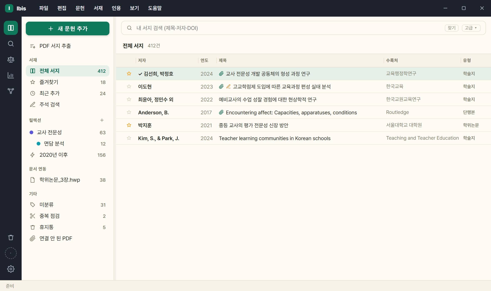
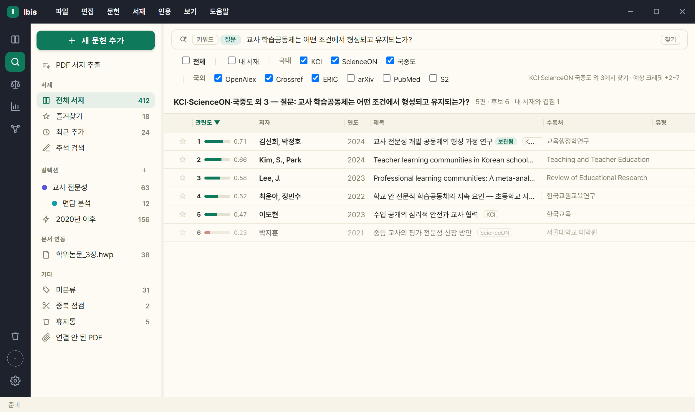
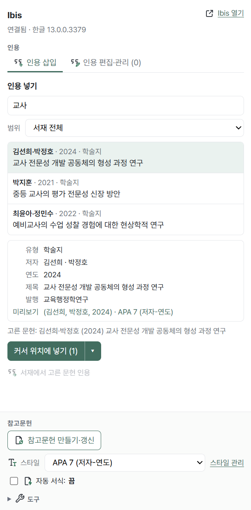
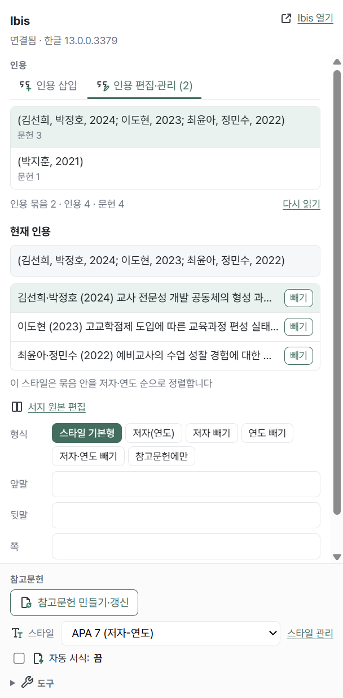
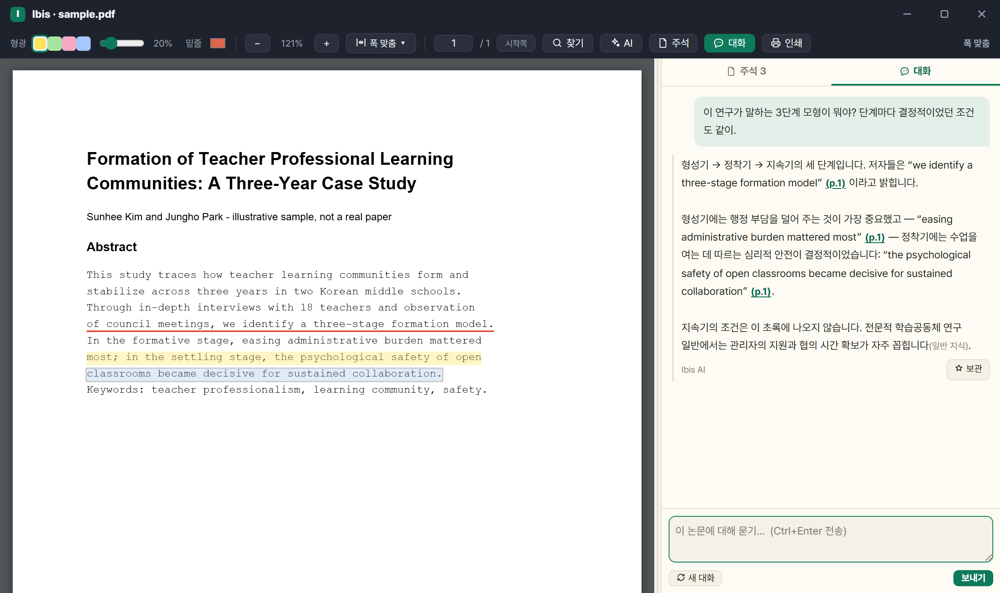
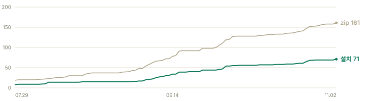

# Ibis — 한국 연구자를 위한 문헌 관리

**Ibis**(아이비스)는 한국어로 연구하는 사람을 위한 문헌 관리 프로그램입니다. 국내 학술 데이터베이스에서 문헌을 찾고, 원문을 받아 읽고, 아래아한글·Word 원고에 인용과 참고문헌을 넣는 일을 한 프로그램에서 합니다.

Windows 10·11용이며 개인·학술·연구·교육 목적으로 무료입니다. 현재 베타입니다.

 &nbsp; 

[홈페이지](https://ibis.dodaseo.cc) · [사용 설명서](docs/USAGE.md) · [자주 묻는 질문](docs/FAQ.md) · [변경 이력](CHANGELOG.md)

## 내려받기

[Releases](https://github.com/dodaseo/ibis-releases/releases/latest)에서 **`Ibis-<버전>-setup.exe`** 를 받아 실행합니다.

- 관리자 권한이 필요 없고, 설치 뒤에는 앱 안에서 새 판을 받습니다.
- 설치할 때 **한글 애드온**과 **Word 애드인**을 따로 고릅니다. 나중에 `⚙설정 › 서재`의 애드온 칸에서 설치·제거할 수도 있습니다.
- 처음 실행하면 「Windows의 PC 보호」 안내가 뜹니다. **추가 정보 → 실행**을 누르면 진행됩니다. 코드 서명 전이라 나타나는 안내이며, 릴리스의 `.sha256` 으로 파일을 확인할 수 있습니다.
- `Ibis-<버전>-win64.zip` 은 앱이 업데이트할 때 받는 파일입니다. 직접 받아 풀면 자동 업데이트·바로가기·제거가 되지 않습니다.

| | |
|---|---|
| 운영체제 | Windows 10 · 11 (64비트) |
| 본문 인용 | 한글 2024(13.0.0.3379 이상) 또는 MS Word. 없어도 검색·원문·읽기·AI·서지 관리는 그대로 됩니다 |
| 계정 | 필요 없습니다. Ibis AI 크레딧·컬렉션 공유·서재 동기화를 쓸 때만 구글 로그인 |

## 하는 일

### 찾기

- **국내외 학술 DB 를 한 번에** — KCI · ScienceON · 국립중앙도서관, OpenAlex · Crossref · ERIC · arXiv · Semantic Scholar · PubMed. 키를 발급받을 필요가 없습니다.
- **질문으로 찾기** — 연구 질의를 문장으로 넣으면 모은 후보를 AI 가 채점해 관련도 순으로 보여 줍니다. 문장 안에 적은 기간·유형·저자·학술지 조건도 검색에 씁니다.
- **법·정책 자료와 통계** — 법령·판례·정책자료·법률안·회의록, KOSIS 통계표. 통계표는 수치를 표로 읽고 캡션·출처와 함께 원고에 옮깁니다.
- DOI·ISBN·기사 주소 한 줄로 서지를 만들고, RIS·BibTeX·CSL-JSON·EndNote(.enw)·RefWorks 파일을 가져옵니다.

### 본문에 인용하기

- **한글**은 우클릭 **[Ibis 작업창]**, **Word** 는 리본 **Ibis 탭**(Alt+1). 문헌 찾기·넣기·고치기·참고문헌 만들기를 문서 안에서 합니다.
- 인용은 누름틀(한글)·콘텐츠 컨트롤(Word)로 들어가, 파일 이름을 바꾸거나 다른 PC 로 옮겨도 유지됩니다. 인용한 서지는 문서 안에도 함께 저장됩니다.
- APA 7 · Vancouver · 번호형 · IEEE · Chicago 17 · MLA 9 와 학회별 양식. 양식을 바꾸면 본문 인용과 참고문헌이 함께 다시 조판됩니다.
- 국문·영문 혼합 정렬, 내어쓰기, 언어·유형별 강조(국문 볼드·영문 기울임 등)를 양식 편집기에서 정합니다.
- 투고 규정이 필드 없는 파일을 요구하면 **제출용 사본**(평문)을 따로 만듭니다. 원본은 그대로 둡니다.

### 원문 받고 읽기

- 공개된 원문(OA)은 자동으로 받아 문헌에 붙입니다. 구독 DB 는 도서관 교외접속으로 원문 페이지를 열어 주고, 내려받기는 직접 합니다.
- 앱 안에서 PDF·EPUB 을 열어 형광펜·밑줄·메모를 답니다. 본문 찾기, 주석 모아보기, 서재 전체 주석 검색.
- **읽으면서 묻기** — 그 문헌 한 편을 근거로 답하고, 답 속 `(p.9)` 를 누르면 근거 문장으로 갑니다.

### 정리하고 분석하기

- 컬렉션(계층·색)·스마트 컬렉션·태그·즐겨찾기, 제목·저자·초록·**첨부 PDF 본문**까지 찾는 서재 검색, 중복 문헌 정리.
- **AI 리서치 노트** — 첨부 원문을 읽어 요지·설계·핵심 결과·한계·인용 포인트(쪽수)를 적고 태그를 답니다. 문헌 유형(실증 논문·저술·보고서·법령·판례·회의록)에 따라 뽑는 내용이 달라집니다.
- **태그 그래프** — 같은 문헌에 함께 달린 태그를 선으로 이어 주제의 연결을 봅니다.
- AI 는 구글 로그인만으로 쓰는 Ibis AI 크레딧(체험 100크레딧, 베타 무료 구독은 하루 50크레딧), Claude Code · Antigravity · Codex CLI, 내 API 키(Anthropic · OpenAI · Gemini), 로컬 AI(Ollama · LM Studio) 가운데 골라 씁니다.

### 나누고 맞추기

- **컬렉션 공유** — 파일 하나(`.ibiscol`)로 건네거나 클라우드로 동료와 계속 맞춥니다. PDF 원문·개인 메모·즐겨찾기는 나가지 않습니다.
- **내 서재 동기화** — 같은 계정으로 로그인한 내 다른 PC 와 서재 전체를 맞춥니다. PDF 원문 파일은 올라가지 않습니다(PDF 개인 보관은 [준비 중](#준비-중)).

## 빠른 시작

| | |
|---|---|
| ① 설치 | 설치할 때 한글 애드온·Word 애드인을 고릅니다 |
| ② 찾기 | 레일의 **찾기**에서 제목·저자·DOI 로 찾거나, **질문** 칩을 눌러 문장으로 묻습니다 |
| ③ 담기 | 결과에서 문헌을 골라 **내 서지에 추가**합니다. 행을 컬렉션으로 끌어도 됩니다 |
| ④ 인용 | Ibis 를 켜 둔 채, 원고에서 작업창(한글)·Ibis 탭(Word)을 열어 문헌을 찾아 **넣기** |
| ⑤ 참고문헌 | **[참고문헌 만들기·갱신]** 을 누르면 문서 끝에 목록이 양식대로 만들어집니다 |

## 문서

| | |
|---|---|
| [사용 설명서](docs/USAGE.md) | [시작하기](docs/usage/01-start.md) · [한글·Word 애드온](docs/usage/02-addons.md) · [검색·수집](docs/usage/03-search.md) · [본문 인용](docs/usage/04-cite.md) · [참고문헌·양식](docs/usage/05-styles.md) · [서지 관리](docs/usage/06-library.md) · [원문·PDF](docs/usage/07-fulltext-pdf.md) · [AI](docs/usage/08-ai.md) · [설정](docs/usage/09-settings.md) |
| [자주 묻는 질문](docs/FAQ.md) | 설치, 문서 연동, 검색, 서지 관리, 양식, 원문, AI, 설정·데이터 |
| [변경 이력](CHANGELOG.md) | 판마다 달라진 점 |
| [개인정보 처리방침](docs/PRIVACY.md) | 무엇이 PC 밖으로 나가는지 |

## 데이터와 이용 조건

- **서재는 이 PC 에 있습니다.** 새로 설치하면 `문서\Ibis` 에 생기고, 위치·백업은 `⚙설정 › 서재`에서 정합니다. API 키·AI 설정·검색 색인은 `%LOCALAPPDATA%\Ibis` 에 남습니다.
- 컬렉션 공유와 서재 동기화는 직접 켰을 때만 해당 데이터를 보냅니다. AI 를 실행하면 필요한 본문·질문이 고른 제공자에게 전달됩니다. 자세한 것은 [개인정보 처리방침](docs/PRIVACY.md).
- **원문 자동 확보는 공개본(OA)만** 대상으로 합니다. 구독 DB 는 기관 인증 창을 열어 주는 데까지 하고, 열람·내려받기는 사용자가 합니다. 도서관과 DB 제공사가 자동화 도구를 통한 접속·대량 내려받기를 제한하는 경우가 있으니, 소속 기관의 정책을 확인한 뒤 본인 책임으로 이용하세요.
- 개인·학술·연구·교육 목적으로 무료입니다. 재배포·판매는 허가하지 않습니다. Ibis 로 만든 서지 데이터와 문서는 사용자의 것입니다.

## 베타 안내

- 베타 기간에는 데이터 구조가 바뀔 수 있습니다. 중요한 원고는 백업해 두고 쓰세요.
- 서재를 여러 PC 에서 동기화한다면 모든 PC 를 같은 최신 판으로 올려 주세요.
- 2026.9.18·2026.9.19 를 쓰고 있다면 앱 안 업데이트 대신 최신 설치 파일로 올려 주세요([변경 이력](CHANGELOG.md)의 안내).
- 문제나 바라는 점은 [Issues](https://github.com/dodaseo/ibis-releases/issues)에 재현 방법과 함께 남겨 주세요.

## 준비 중

일정은 확정이 아니며 순서나 방식이 바뀔 수 있습니다.

| | |
|---|---|
| 해외 구독 저널 원문 | 지금은 국내 DB 까지 도서관 경유로 이어 줍니다. 해외 구독 저널도 같은 방식으로 이어 줄 예정입니다 |
| 관련 문헌 추천 | 인용 관계를 바탕으로 관련 문헌을 추천합니다 |
| PDF 개인 클라우드 보관 | 지금 서재 동기화는 서지·주석까지이고 PDF 원문 파일은 올라가지 않습니다. 내 다른 PC 에서 PDF 까지 받을 수 있게 하는 개인 보관을 준비하고 있습니다. 지금은 일부 계정에서 시험하고 있습니다. 남과 나누는 데는 쓰이지 않습니다 |
| macOS 판 | 검색·원문·읽기·AI·서지 관리는 옮길 수 있지만 한글 본문 인용은 Windows 전용입니다. 수요를 보고 판단합니다 |

## 사용 현황

<!-- DL-STATS:START -->
<!-- 이 블록은 .github/workflows/dl-stats.yml 이 매일 생성합니다. 직접 고치지 마세요. -->

최신 기록 **2026-11-10** · 누적 합계 **1196건** (설치 82 · zip 187)

<picture>
  <source media="(prefers-color-scheme: dark)" srcset="stats/downloads-dark.svg">
  
</picture>

> 설치 프로그램은 **새로 설치한 사람**에 가깝고, zip 은 **인앱 업데이트**가 섞입니다.

자세한 표는 [stats/README.md](stats/README.md), 원본은 [stats/downloads.csv](stats/downloads.csv).

<!-- DL-STATS:END -->
