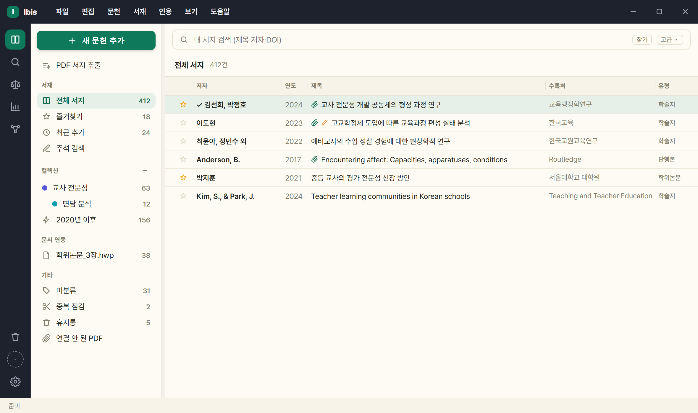
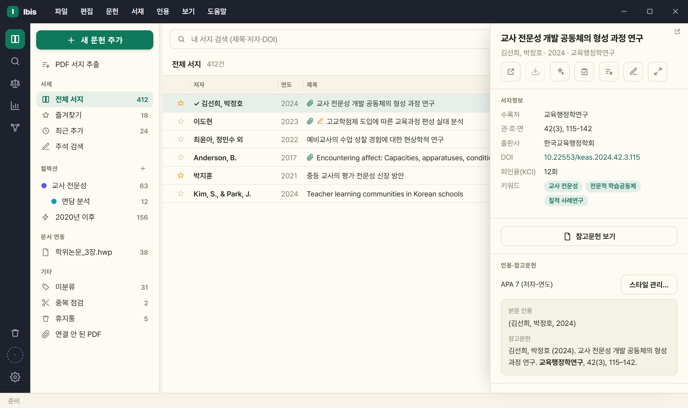

# 1. 시작하기 — 설치·실행·화면

[사용 설명서 목차](../USAGE.md)

## 1.1 요구 환경

- Windows 10/11.
- **본문 인용(CWYW)** 을 쓰려면 한글 2022/2024 또는 MS Word. 없어도 나머지 기능은 모두 동작합니다.
- 별도 런타임 설치 불필요(파이썬·서재 모두 포함).

## 1.2 설치

[릴리스 페이지](https://github.com/dodaseo/ibis-releases/releases/latest)에서 **`Ibis-<버전>-setup.exe`** 를 받아 실행합니다. 관리자 권한이 필요 없고, 시작 메뉴·바탕화면 아이콘이 생기며 제어판에서 지웁니다.

- **설치 위치를 묻지 않습니다** — `%LOCALAPPDATA%\Programs\Ibis` 에 설치됩니다. 인앱 업데이트가 이 폴더를 직접 교체하므로 쓰기 권한이 있는 위치여야 합니다.
- 첫 실행 시 SmartScreen 경고(코드 서명 없음) → `추가 정보 → 실행`. 릴리스의 `.sha256` 으로 무결성 확인 가능.
- **'한글 애드온 설치'·'Word 애드인 설치'** — 설치 중 작업 선택 화면에서 따로 고릅니다. 한글 항목은 한글 2024
  13.0.0.3379 이상이 있을 때만, Word 항목은 Word 가 있을 때만 보입니다. 고르지 않은 쪽은 아무것도 남기지 않고, Ibis 를 제거하면
  함께 제거됩니다. 한글이 켜진 채 설치하면 애드온 교체는 한글을 닫은 뒤 Ibis 가 이어서 합니다. 쓰는 법은 [2.2절](02-addons.md#22-한글-작업창).
- ⚠ 릴리스에 함께 있는 **`Ibis-<버전>-win64.zip` 은 앱이 업데이트할 때 스스로 내려받는 파일**입니다. 사람이 받아 푸는 용도가 아니며, 그렇게 쓰면 자동 업데이트·바로가기·제거가 되지 않습니다.
- **서재(서지·첨부)는 설치 폴더 밖**에 있어 제거·재설치·업데이트로 지워지지 않습니다. 새로 설치하면 **`문서\Ibis`** 에 생깁니다(쓰던 분의 서재는 옮기지 않습니다). API 키·테마·글꼴·검색 색인은 `%LOCALAPPDATA%\Ibis` 에 남습니다.
- 설치 프로그램 마지막 화면의 **'AI 연동 설정 열기'** 체크박스(기본 꺼짐) — 켜면 앱이 AI 설정 화면부터 열립니다(인스톨러가 AI CLI 를 대신 설치하지는 않습니다).

## 1.3 최초 실행 온보딩

'Ibis 시작하기' 창이 3단계로 뜹니다. **전부 선택 사항**이며 [나중에]로 건너뛸 수 있습니다.

1. **`1 · 서재 위치`** — 기본은 `문서\Ibis`. 클라우드 폴더로 지정하면 여러 PC 동기화.
2. **`2 · 이메일`** — **이메일 하나만** 넣습니다(Unpaywall·polite pool).
3. **`3 · AI`** — 제공자 + API 키. Codex를 포함한 CLI를 고르면 '이 CLI 설치…' 버튼이 나타납니다. 로컬 AI는 설치 후 `⚙설정 › AI`에서 연결합니다.

- 버튼은 `나중에` / `저장하고 시작`.
- 검색은 온보딩에서 설정할 것이 없습니다 — KCI·국립중앙도서관은 앱 내장 키로 바로 동작합니다([3.1](03-search.md#32-검색-소스)).
- 건너뛴 항목은 언제든 `⚙설정` 에서 설정 가능.
- 이미 데이터가 있는 사용자에게는 온보딩이 다시 뜨지 않습니다.

## 1.4 화면 구성

| 영역 | 하는 일 |
|---|---|
| **타이틀바** | 메뉴(파일·편집·문헌·서재·인용·보기·도움말 — Alt+F·E·R·L·C·V·H) |
| **레일**(맨 왼쪽) | 서재 · **찾기(학술)** · **법·정책**(저울) · **통계**(막대) · 그래프 뷰 전환(찾기 셋은 *어디서* 찾을지고, 낱말/문장은 찾기 줄의 **키워드 \| 질문** 칩). 찾기 모드가 **같은 서재 사이드바**를 쓰고(어느 모드에서든 컬렉션을 누르면 그 뷰로 갑니다), 찾기 줄과 그 아래 DB 체크 행도 같은 자리입니다. 아래쪽에 휴지통 · **계정 동그라미**(로그인하면 구글 사진) · **⚙설정**(맨 아래). 참고문헌 갱신은 [4.5](04-cite.md#45-전체-갱신--참고문헌-만들기갱신) 의 자리에서 합니다 |
| **사이드바** | 맨 위 **'새 문헌 추가'** 버튼(추가 방법 메뉴 런처) + 서재 · 컬렉션 · 스마트 컬렉션 · 문서 연동(작업창이 붙은 문서) · 기타(미분류·중복 점검·휴지통·연결 안 된 PDF) |
| **목록** | 검색줄 + 필터 칩 + 정렬·폭 조절 가능한 문헌 표 |
| **상세 패널** | 서지정보 · 인용 미리보기 · 첨부. 원문·AI 동작 버튼 |
| **상태 표시줄** | 진행 메시지 · 선택 건수 · 현재 모드 |

- **레일 아이콘을 다시 누르면 그 패널이 접힙니다**(목록을 넓게 볼 때). 그래프 모드에서는 그래프 패널이 접힙니다.
- **서재가 바뀌면 화면이 바로 갱신됩니다** — 서지·태그·AI 노트·컬렉션이 바뀌면 클릭 없이 목록·상세·사이드바 건수에 반영됩니다. 입력 중이면 상세는 손을 뗀 뒤 반영되고, 검색·질문 결과 화면은 덮지 않습니다.
- **메뉴바와 `⚙설정` 의 경계** — 메뉴바에는 *지금 하는 일* 이, 설정에는 *한 번 정해 두는 것* 이 있습니다. `파일` = 새 문헌 추가·가져오기·내보내기, `편집` = 모두 선택(Ctrl+A)·찾기(Ctrl+F), `문헌` = 서지 편집(F2)·즐겨찾기·원문 확보·AI 분석, `서재` = 컬렉션·공유·동기화·서재 정리(중복 문헌·원문 일괄 확보·AI 태그·첨부 이름), `인용` = 스타일 관리, `보기` = 서재·찾기 화면 전환과 태그 그래프(Ctrl+G), `⚙설정` = 서재 위치·API 키·AI·클라우드([9절](09-settings.md)).
- 문헌을 고르면 오른쪽에 상세 패널이 열립니다.
- **'새 문헌 추가'**(사이드바 맨 위)는 폼을 바로 열지 않고 **추가 방법 메뉴**를 띄웁니다 — `새 문헌 추가 — DOI·ISBN·인용문·직접 입력…`(Ctrl+N) / `파일로 서지 가져오기 (RIS·BibTeX·CSL)…` / `국내 학술 DB 온라인 검색 (KCI·국립중앙도서관)…` / `해외 학술 DB 온라인 검색 (OpenAlex·Crossref)…`. 뒤의 둘은 각각 '국내 통합'·'해외 통합' 검색으로 이동합니다.

## 1.5 최소화·트레이·종료

- **− 버튼**은 창을 작업표시줄로 최소화합니다.
- **본창의 × 또는 Alt+F4**는 창을 숨기고 시스템 트레이에서 계속 실행합니다. PDF 본문 색인·서재 동기화 등 진행 중인 작업도 계속됩니다. ×로 앱을 끝내고 싶으면 `⚙설정 › 일반 › 창 닫기(✕)` 를 **앱 종료**로 바꾸세요.
- 다시 열려면 작업표시줄 오른쪽 **Ibis 트레이 아이콘을 클릭**하거나, 아이콘을 오른쪽 클릭한 뒤 **Ibis 열기**를 선택합니다. 아이콘이 보이지 않으면 숨겨진 아이콘 목록(⌃)을 확인하세요.
- 앱을 완전히 끝내려면 **파일 › 종료** 또는 **트레이 메뉴 › 종료**를 선택합니다. 업데이트를 설치할 때와 Windows 종료·로그오프 때도 앱을 완전히 종료합니다.
- 설정·PDF·상세 같은 **별도 창의 ×는 그 창만 닫습니다.**

---

[목차](../USAGE.md) · [2. 한글·Word 애드온 — 문서 안에서 인용하기 →](02-addons.md)
