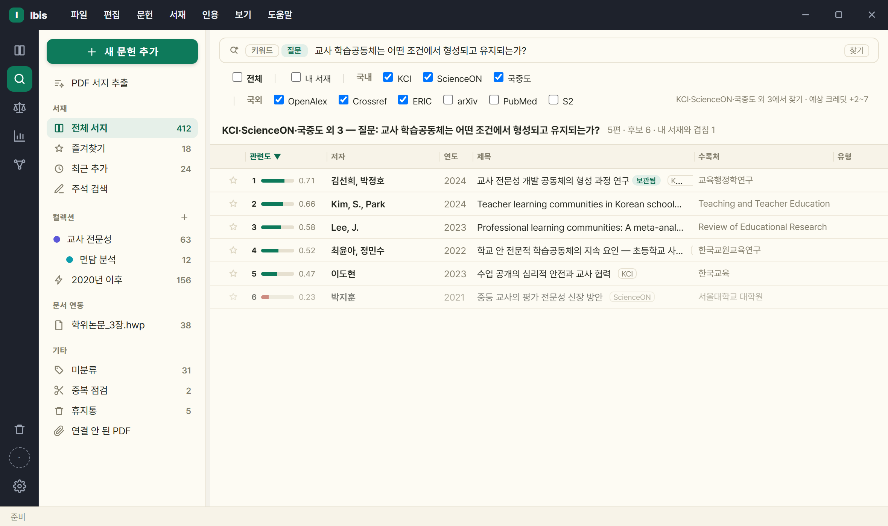
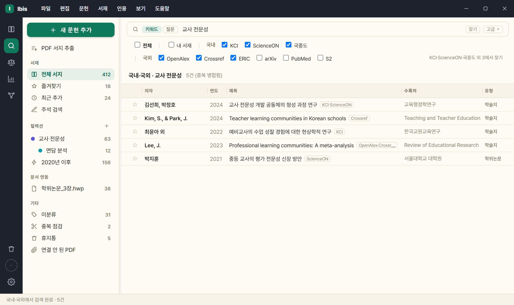

# 3. 문헌 검색·수집

[사용 설명서 목차](../USAGE.md)

## 3.1 질문으로 찾기

연구 질의를 문장으로 입력하면 국내외 학술 DB 를 검색해 관련도 순으로 보여 줍니다. 레일 **찾기(학술)** 아이콘을 누르고 찾기 줄 왼쪽의 **[질문]** 칩을 켭니다(별도 아이콘이 아니라 키워드/질문 **모드 칩**입니다. 통계 아이콘에서도 됩니다 — [3.2-1](#32-1-통계kosis--표-찾기--수치-보기--데이터세트로-인용); 법·정책은 키워드뿐).

결과는 키워드로 찾기와 같은 표에 나옵니다. 맨 왼쪽에 **관련도 칸**(순위 · 막대 · 0~1 점수)이 하나 더 붙고, 그 칸은 질문으로 찾기에서만 보입니다. 최근 질의와 사정 고지(잘린 것·빠진 것·실패)는 표 바로 위 한 줄에 있습니다. 질의에서 읽어 적용한 조건도 여기 **조건 …** 으로 적힙니다.

1. 질의를 문장으로 적습니다 — 예: `국내 교육사회학 연구에서 교육불평등을 어떻게 다뤄 왔나`.
2. 찾기 줄 아래 **체크 행**에서 어디서 찾을지 고릅니다: `전체` │ **내 서재** │ **국내**(KCI·ScienceON·국립중앙도서관) │ **국외**(OpenAlex·Crossref·ERIC·arXiv·PubMed·S2). 행 오른쪽 끝에 지금 조합(`KCI·ScienceON·국중도 외 3에서 찾기`)과 **예상 크레딧**(`+2~7` 처럼)이 적힙니다. **키워드로 찾기와 같은 목록·같은 기억**입니다(한쪽에서 끄면 다른 쪽도 꺼져 있습니다).
   - **내 서재 칸은 기본이 꺼짐**입니다 — 꺼져 있으면 DB 에서만 찾고, 그중 이미 담아 둔 것에는 **[보관됨]** 배지가 붙습니다. 켜면 서재 문헌도 후보로 순위에 함께 듭니다. 키워드로 찾기에도 같은 칸이 있습니다(켜면 서재에서 같은 검색어로 찾은 문헌이 [보관됨]으로 함께 서고, 서재만 켜면 서재 검색).
   - **법·정책 다섯 갈래는 여기에 없습니다** — [3.2](#32-검색-소스) 의 키워드로 찾기에서만 씁니다. 갈래마다 채점에 쓸 본문 길이가 크게 달라 순위가 치우치기 때문입니다.
3. 진행이 단계로 보입니다 — `검색어 만들기 → DB에서 찾기 → 관련도 매기기 → 정리`(지금 단계가 점멸).
4. 최근 질의는 셋만 보이고 나머지는 **[+N ▾]** 에 접혀 있습니다 — 누르면 **크레딧 0** 으로 그때 결과가 되살아납니다.

- 검색어 생성과 관련도 채점은 AI 가 합니다. 낱말을 직접 고르지 않아도 됩니다.
- 모은 후보(보통 200여 건)를 전부 채점해 100여 편을 순위로 보여 줍니다.
- 국립중앙도서관 단행본도 순위에 오릅니다. 책소개가 없으면 카카오 책에서 가져와 채점합니다.
- **크레딧을 씁니다**(Ibis AI 를 쓸 때) — 검색어 만들기와 채점에 들어갑니다. 체크 행 오른쪽 끝에 **예상 크레딧**이 미리 뜨고(한글 질의는 검색어 생성이 붙어 `+2~7`), 남은 양은 화면에 표시됩니다.
- 이전 결과는 최근 질의 목록에서 누르면 크레딧 소모 없이 다시 표시됩니다. 외부 문헌 행을 누르면 상세가 열리고 거기서 내 서재에 담습니다.
- **저자·학술지만 묻는 질문에는 관련도가 없습니다** — "양연동의 연구물을 찾아줘" 처럼 주제 없이 사람이나 학술지만 물으면 **저자 검색**으로 가고, 관련도 칸 대신 **최신순**으로 섭니다. 관련도는 주제의 일치 정도를 재는 값이라 저자 검색에는 맞지 않기 때문이며, 채점을 건너뛰므로 크레딧도 들지 않습니다.

- **질의에 적은 조건을 읽습니다** — `2015년 이후`·`학위논문만`·`OO 저자`·`OO학회지`·`양적 연구는 빼고` 처럼 문장 안에 넣은 기간·유형·저자·학술지·제외·선호가 그대로 DB 에 보내는 검색 조건이 됩니다. 따로 칸을 채우지 않아도 됩니다.

- **사이드바를 누르면 질문 화면을 닫고 그 뷰로 갑니다** — 키워드로 찾기와 같은 동작입니다. 결과는 남아 있어 돌아오면 그대로이고, 결과 행을 컬렉션에 끌어 넣는 것도 그대로입니다.
- **여러 개 골라 한 번에** — Ctrl 클릭으로 더하거나 빼고 Shift 클릭으로 범위를 고른 뒤 끌면 고른 전부가 컬렉션으로 갑니다(서재 목록과 같은 규칙).
- **'많이 인용된·대표적인·고전적인' 조건이 순위에 실제로 반영됩니다** — 해외 DB(OpenAlex·Crossref)의 피인용 수를 새로 담고(상세의 '피인용(해외 DB)' 줄) KCI 피인용과 따로 정규화합니다. 관련도가 분명히 낮은 문헌이 피인용만으로 앞서지는 않습니다.

> 낱말로 찾는 것은 **키워드로 찾기**([3.2](#32-검색-소스))입니다. 질문으로 찾기는 무엇을 찾아야 할지부터 넓게 볼 때 씁니다. 낱말로 찾으면 키워드로 찾기, 문장으로 물으면 질문으로 찾기입니다.
>
> 두 찾기는 **같은 자리(찾기 줄 아래)에서 같은 방식**으로 DB 를 고르고, **목록도 기억도 같습니다**(내 서재 칸·S2 둘 다 양쪽에). 법·정책은 별도 아이콘(레일 셋째)이고 키워드로만 찾습니다. 물음표로 끝나는 검색어에는 질문 모드를 권하기만 하고 자동으로 바꾸지는 않습니다(크레딧이 들기 때문입니다).

## 3.2 검색 소스

레일의 찾기 아이콘 셋이 **어디서 찾을지(범위)** 입니다: **찾기(학술)** — 체크 행 `전체 │ 내 서재 │ 국내 KCI·ScienceON·국중도 │ 국외 OpenAlex·Crossref·ERIC·arXiv·PubMed·S2`(arXiv·PubMed·S2·내 서재는 **기본 꺼짐**) / **법·정책**(저울) — `법령·판례·정책자료·법률안·회의록` / **통계**(막대) — KOSIS 하나라 체크 없이 안내 한 줄. 범위가 갈려 있어 법령 몇 건 사이에 논문 수백 건이 끼지 않고, 조합은 **범위마다 따로** 기억됩니다. **'국내'·'국외' 글자를 누르면 그 묶음이 통째로 켜지고 꺼지며**, 원하는 대로 섞어도 됩니다(KCI+ERIC 만 같은 조합도 가능). 행 오른쪽 끝에 `○○에서 찾기` 라고 지금 조합이 적힙니다(고른 것이 없으면 'DB 를 하나 이상 고르세요'). 낱말로 찾을지 문장으로 물을지는 찾기 줄 왼쪽의 **키워드 \| 질문** 칩입니다.

소스는 **국내 3종 · 해외 6종 · 법·정책 5갈래** 이며, 둘 이상을 켜면 병렬로 질의한 뒤 중복을 합칩니다.

> **법·정책을 켜면 학술 DB 는 함께 검색하지 않습니다**. 결과가 섞이면 구분해 찾는 의미가 없기 때문입니다. 학술을 켜면 법·정책이 꺼지고, 그 반대도 같습니다.
> **법·정책은 칸 하나가 한 인용 갈래**입니다(기관 이름이 아니라 인용할 때 부르는 이름). 담으면 바로 참고문헌 서식이 나옵니다 — `교육부 (2026). 초ㆍ중등교육법. 법률, 제21659호(시행 2026. 8. 20.).`
> **관련도순만 고를 수 있습니다**(두 API 모두 정렬 인자를 받지 않습니다).

| 묶음 | 소스 | 커버리지 | 키 |
|---|---|---|---|
| 국내 | **KCI** | 국내 학술논문 | **불필요(앱 내장)** |
| 국내 | **ScienceON** | 국내 학술·학위논문(KISTI) | **불필요(앱 내장)** |
| 국내 | **국립중앙도서관** | 학위논문·도서·연속간행물·웹자료 등 국내 발행물 | **불필요(앱 내장)** |
| 해외 | OpenAlex | 국제+국내 상당수 | 불필요 |
| 해외 | Crossref | 국제+국내 상당수 | 불필요 |
| 해외 | ERIC | 교육학(미국 교육부 IES) — 저널논문(EJ)·문서/보고서(ED) | 불필요 |
| 해외 | arXiv | 프리프린트 | 불필요 |
| 해외 | Semantic Scholar(S2) | CS·융합 | 불필요 |
| 해외 | **PubMed** | 의학·보건·간호(미국 국립의학도서관) — 초록·MeSH 주제어 포함, 총건수 표시. 주제 범위가 좁아 **해외 통합·질문으로 찾기에서는 기본 꺼짐** | 불필요 |
| 법·정책 | **법령** · **판례** | 법제처 국가법령정보 — 현행법령·자치법규, 대법원·하급심 판례 | **불필요(앱 내장)** |
| 법·정책 | **정책자료** · **법률안** · **회의록** | 국회도서관 — 공공기관 정책자료(회색문헌), 국회 의안, 국회 회의록 | **불필요(앱 내장)** |
| — | 내 서지 | 보관한 문헌 — 키워드·질문 두 찾기 모두 **'내 서재'** 칸이 있습니다(기본 꺼짐). 켜면 서재에서 같은 검색어로 찾은 문헌이 결과에 **[보관됨]**으로 함께 서고, 서재만 켜면 서재 검색이 됩니다. 서재 모드의 찾기 줄([3.8](#38-내-서지-전문검색fts))은 그대로입니다 | — |

- **KCI 와 국립중앙도서관은 앱 내장 키로 동작합니다** — 사용자가 발급받을 것이 없고 설정에 입력 칸도 없으며, 설치 직후부터 소스 목록에 보입니다.
- **모든 학술 DB 와 법·정책이 앱 내장 키로 동작합니다**. 발급받을 키가 없습니다. ScienceON 인증키 입력 칸도 없앴습니다.
- DB 가 실패하면 체크 행의 그 칸에 ⚠ 가 붙고(툴팁에 사유), 안내줄에 "이 DB 의 결과는 빠져 있습니다. 0건이어도 자료가 없다는 뜻이 아닙니다" 가 남습니다. 경고는 그 DB 를 다시 불러 성공했을 때 지워지고, 체크를 자동으로 끄지는 않습니다.
- 학술논문은 KCI 가, 그 밖의 국내 발행물은 국립중앙도서관이 맡습니다. 유형을 지정하지 않은 국립중앙도서관 검색은 소장자료 네 갈래를 동시에 검색합니다.
- RISS 는 검색 소스가 아니라 **원문 확보 경로 전용**입니다([7절](07-fulltext-pdf.md)).
- 찾기: **체크 행에서 DB 고르기 → 낱말 입력 → Enter** → 페이지당 20건. 체크를 바꾸면 목록이 새 조합으로 바뀌고, 실제 검색은 Enter 로 합니다(질문으로 찾기와 같습니다).

**열람 상한** — 소스가 내주는 범위에 한계가 있습니다.

- 국립중앙도서관: 한 갈래마다 상위 500건(유형 미지정이면 네 갈래 합쳐 최대 2,000건).
- KCI: 상위 10,000건. 단 검색창에 필드 지정 없이 친 말은 제목·저자·키워드 세 갈래로 나눠 물어 합치므로 **약 540건**에서 끝납니다.
- 합집합(「또는」 묶음·'전체' 펼침)은 병합 1,000건까지.

**총건수 표시** — 목록 머리에 `20건 (총 465건)`, 상태줄에 `국립중앙도서관 · 총 332건 중 20건` 처럼 나옵니다. 총건수를 알려 주지 않는 소스(Crossref·OpenAlex·S2·arXiv·ERIC)는 미상으로 두고 숫자를 적지 않습니다.

## 3.2-1 통계(KOSIS) — 표 찾기 · 수치 보기 · 데이터세트로 인용

레일의 **통계** 아이콘은 KOSIS 국가통계포털의 통계표를 찾습니다(내장 키 — 설정 없음). 표 하나가 서지 하나(**데이터세트** 유형)입니다.

- **키워드** — 통합검색은 검색어 하나·한 번에 최대 20건·쪽 넘김 없음. 더 보려면 검색어를 좁히세요. 같은 작성기관·같은 표명의 **연도별 표는 최신 표 하나로** 합쳐 보이고 다른 연도는 표 주석에 적힙니다. 목록 열은 작성기관 · 연도 · 통계표명 · 통계조사.
- **목록이 통계조사별로 묶입니다** — 머리줄에 `조사명 · 표 수 · 작성기관`이 서고, 표마다 둘째 줄에 **수록 기간과 분류 경로**가 붙습니다. 한 조사에 표가 많을 때 무엇을 볼지 고르는 데 씁니다. 정렬을 바꿔 조사가 흩어지면 머리줄은 사라집니다.
- **질문** — "초등학생 1인당 월평균 사교육비는 얼마나 되나?" 처럼 문장으로 물으면 표를 모아 **관련도 순**으로 돌려줍니다. 상위 5개 표는 최근 시점 수치가 행에 발췌로 미리 보입니다. 크레딧은 학술 질문과 같습니다.
- **상세**(서지 상세와 다른 화면) — 표명·작성기관·조사·수록 기간 → **[수치 보기]** → 분류 경로·표 주석 → 인용 → 서지 정보. 피벗·차트는 [KOSIS 에서 보기]로, 원자료는 **[CSV 저장]**(분류 코드·이름·항목·단위·시점·값)으로 받습니다. 한 번에 4만 셀까지(KOSIS 제한) — 넘으면 시점 수나 항목을 좁히라고 알립니다.
- **수치 표는 분류·항목이 행, 시점이 열입니다** — 오래된 시점부터 오른쪽으로 가고 첫 열은 고정돼 스크롤해도 이름이 남습니다. 기본 항목은 첫 항목(대개 '전체')이고 '항목 전체'는 조작 칸에서 고릅니다.
- **[표 복사]** — 원고에 바로 넣을 표를 클립보드에 담습니다: `<표>` 캡션(항목·단위) + **탭 구분 표** + `자료:` 출처 문장(지금 스타일의 참고문헌 항목). 한글·Word·엑셀에 그대로 붙습니다. 표 모양을 원자료 그대로 원하면 [CSV 저장] 쪽입니다.
- **담기·인용** — 담는 순간 **인출일**이 오늘로 적힙니다(수치는 갱신되므로 언제 봤는지가 서지의 일부). 인용은 `국가데이터처 (2025). 학교급별 학생 1인당 월평균 사교육비 [데이터세트]. 초중고사교육비조사. 2007~2025. KOSIS 국가통계포털. URL (인출일: 2026. 9. 9.)` 꼴이고, 영문 APA·Vancouver·IEEE·Chicago·MLA 도 됩니다. 데이터세트에는 PDF 확보·AI 노트·검토 버튼이 없습니다.

## 3.3 여러 DB 를 한 번에(병렬 + 중복 병합)

- 체크 행에서 **둘 이상 켜면** 켠 DB 를 **동시 질의**합니다. **국내**(KCI·ScienceON·국중도)나 **국외**를 통째로 켜는 것이 흔한 쓰임이지만, 조합은 자유입니다.
- 병합 기준: **DOI 우선**, 없으면 정규화 제목+연도 → 출처를 누적 표시.
- 일부 소스가 실패(키 미설정·429)해도 나머지는 진행하고, 실패한 소스명이 결과 제목줄에 함께 보고됩니다.

## 3.4 DOI 즉시 서지화

- **방법 A** — 검색창에 DOI(또는 doi.org URL) 붙여넣기 → 소스 무관하게 1건 해석('내 서지' 소스만 예외).
- **방법 B** — `새 문헌 추가` 창의 **식별자로 채우기** 칸에 DOI 를 넣고 **[바로 저장]** → 해석 후 곧바로 내 서지에 보관.
  - 옆의 **[조회]** 는 대신 아래 양식을 채웁니다 — 확인·수정한 뒤 [추가]. 여러 건을 연달아 넣을 때는 [바로 저장]이 빠릅니다.
- doi.org content negotiation 사용 → 등록기관(Crossref·DataCite·mEDRA) 무관, 키 불필요.
- 국문 논문은 저장 시 DOI 로 KCI 를 조회해 국문 제목·학술지·한글 저자를 보강합니다.
- 형식 오류는 'DOI 형식이 아닙니다', 해석 실패는 'DOI 해석 실패'로 안내.

## 3.5 ISBN으로 단행본 추가

논문의 DOI 에 해당하는 단행본의 식별자는 **ISBN** 입니다. 학술 DB(KCI·Crossref)는 단행본을 거의 담지 않으므로 도서관·서점 데이터로 조회합니다(논문의 'DOI로 채우기'에 대응하는 단행본용 기능).

- **추가** — `새 문헌 추가` 창의 **식별자로 채우기** 칸에 ISBN(하이픈 있어도 됨)을 넣고 **[바로 저장]**. 조회 후 단행본 서지가 곧바로 내 서지에 보관됩니다.
- **폼에서 조회** — '서지 직접 추가' 또는 서지 편집 폼의 ISBN 칸 옆 **'조회'** 버튼 → 제목·저자·발행처·출판지·연도·판차 등 **빈 칸만** 채웁니다(입력한 값은 보존).
- 조회 순서: **국립중앙도서관(서지정보유통) → OpenLibrary → Google Books.** 먼저 확인된 값을 우선하고 남은 빈 필드만 뒤 소스로 보강합니다.
- **국내서 조회에 설정할 것이 없습니다** — 국립중앙도서관은 앱 내장 키로 동작합니다. 해외서는 OpenLibrary 로 조회됩니다. Google Books 만 선택적으로 키를 넣을 수 있습니다([9.1](09-settings.md#91-api-키이메일-발급)).
- 찾지 못하면 'ISBN 서지를 찾지 못했습니다' 안내 → 직접 입력으로 추가([6.8](06-library.md#68-서지-직접-추가)).

국중도 상세 서지에서 확인한 번역서의 원저자 이름은 원어로 저장하고, 번역서명·원제·역자·편저자를 구분합니다. 원어 근거가 없으면 추정하지 않으며 직접 수정한 정보는 보존합니다. 연구보고서의 책임·공동 연구진과 보조 인력도 구별합니다. 알라딘 연동은 종료했으며, 카카오·국중도 보완과 기존 저장 서지는 유지합니다.

## 3.6 고급 검색(다중 조건)

검색창 옆 **'고급'**. 조건 줄을 ＋로 쌓아 올립니다.

- 한 줄 = `[그리고/또는][필드][포함/정확히 이 구][값]`.
- 한 묶음 **8줄**, 「또는」 묶음 **3개**까지. **「그리고」가 「또는」보다 먼저 묶입니다.**
- 비교는 `포함` / `정확히 이 구`. 일부 필드(DOI·ISBN·분류기호·자료구분·수록연도)는 `일치` 고정.
- 검색어에 낱말을 여럿(쉼표·공백) 쓰면 그 낱말을 **모두 든** 자료를 찾습니다.
- 빈 칸은 조건에서 제외, 적용된 조건은 결과 제목줄에 요약 표시.
- 고급검색을 열면 검색창의 글자가 **첫 조건 줄로 옮겨 갑니다**(닫으면 되돌립니다).

**필드 그룹 4개**

| 그룹 | 필드 |
|---|---|
| **공통** | 전체 · 제목 · 저자 · 발행처·학술지 · 키워드 |
| **KCI 전용** | DOI · 저자 소속기관 · 발행기관 |
| **국립중앙도서관 전용** | ISBN·ISSN · 분류기호 · 자료구분 · 수록연도 |
| **내 서지 전용** | 초록 · 첨부파일명 |

- 전용 필드를 고르면 **위 체크 행이 그 DB 로 바뀝니다**. 그 DB 가 지원하지 않는 조건은 이유를 안내줄에 적습니다.

**전역 한정자**(행이 아니라 질의 전체에 걸립니다)

- **유형(공통)** · 정렬 · 발행년 범위. 유형에 **법령·조례**와 **데이터세트**가 있습니다. (어느 DB 에서 찾을지는 고급 검색 안이 아니라 **찾기 줄 아래 체크 행**입니다.)
- **고급 검색은 범위를 따릅니다** — 법·정책과 통계는 두 API 다 검색어 하나만 받으므로 조건 줄이 하나(필드 '전체' 고정)이고 정렬 줄은 없습니다(관련도순뿐). 통계는 유형 줄 대신 **작성기관·통계조사** 칸(받은 목록 안에서 거름)과 **수록 기간(겹침)**, 법·정책은 **연도(시행·선고·제안·회의)** 를 씁니다(통계의 연도는 수록 기간과 겹치면 걸리므로 `2015~2020` 이 1992~2026 수록 표를 제외하지 않습니다).
- 유형 값: 전체 · 학술논문 · 학위논문 · 단행본 · 보고서 · 연속간행물 · 웹자료 · 비도서(소스마다 고를 수 있는 값이 다릅니다).
- `자료구분`(국립중앙도서관 전용)은 서버로 그대로 보내는 **자료 종별 13종**(일반도서·학위논문·정부간행물·공공간행물·아동도서·교과서·학습참고서·한장본·점자도서·장애인대체자료·비도서·연속간행물·온라인자료)이며 '유형(공통)' 과는 다릅니다.
- ⚠ **'단행본'·'보고서' 유형은 그 갈래의 일부만 찾습니다** — 국립중앙도서관 자료구분은 한 번에 하나만 보낼 수 있어 대표 코드 하나로 묻습니다(단행본=일반도서만, 보고서=정부간행물만). 앱이 이 사실을 결과줄에 매번 밝힙니다.
- 초록 검색과 제외(NOT)는 넣지 않았습니다. KCI 는 초록 조건을 적용하지 않고, 국립중앙도서관 응답에는 초록 필드가 없기 때문입니다. 초록은 **'내 서지'** 에서만 고를 수 있습니다.

**다중 조건을 못 받는 소스** — ScienceON · OpenAlex · Crossref · ERIC · arXiv · S2 · 해외 통합.

검색이 도는 동안 페이지 버튼이 잠기고 `N쪽 불러오는 중…` 이 뜹니다.

## 3.7 페이지네이션

- 외부 소스는 페이지당 20건 → 하단 페이지 바(`‹ 1 2 3 … ›`).
- 페이지를 넘겨도 이전 결과는 인용 대상으로 유지.
- '다음 페이지 있음'은 '이번 페이지가 20건으로 참'으로 추정 → 마지막에 빈 결과가 한 번 나올 수 있음.
- 소스 한계: Crossref 오프셋 약 1만, S2 오프셋+개수 최대 1000.
- '내 서지' 검색은 전체를 한 번에 표시(페이지 바 없음).

## 3.8 내 서지 전문검색(FTS)

- 검색 범위: 제목·저자·수록처·태그·키워드·**AI 요약(노트)**·초록·영문 병기 + **첨부 파일명**.
- 검색어 **3자 이상** → FTS5(트라이그램), **2자 이하** → 제목·수록처 LIKE 폴백.
- 고급 검색에서 필드를 좁히거나 파일명 검색이면 FTS 대신 지정 필드만 봅니다.
- **첨부 PDF 본문까지** — '전체' 검색이 첨부 PDF 의 글자까지 봅니다. 제목·초록에 없는 낱말이 PDF 에 있으면 그 문헌이 뒤에 추가되고 행 아래 **발췌 한 줄**(일치 부분 강조)이 보입니다. 고급 검색에 **본문(PDF)** 필드가 생겼습니다. 색인은 첨부 뒤 배경에서 저절로(부팅 뒤·첨부 뒤 1분 안) 만들어지고, 상태와 [지금 색인]은 `⚙설정 › 서재 › PDF 본문 색인` 에 있습니다. 스캔본은 글자 인식 뒤에 잡힙니다. 색인은 낮은 우선순위로 돌고 상태줄에 `k/할 것` 진행이 보입니다(새로 바뀐 파일만 셉니다). 엔진을 바꿔 서재 802편 기준 43분 → 3.4분입니다. 누르거나 입력하는 동안에는 다음 파일을 열지 않아, 색인 중에도 앱이 바로 반응합니다.

## 3.9 검색 결과에서 더 하는 일

**검색어 하이라이트** — 제목·저자·수록처에서 검색어와 일치하는 부분을 표시합니다.

- 제목·저자·수록처 어디에도 검색어가 없으면 일치한 칸을 표시합니다(`일치: 초록·주제어` 처럼).
- 검색 결과 화면에서만 표시합니다.

**참고문헌 계보 따라가기** — 어떤 논문이 무엇을 인용했는지 보고, 그중 필요한 것을 바로 담습니다.

- 문헌 상세에서 **[참고문헌 보기]** → 그 논문이 인용한 문헌 목록이 뜨고, 거기서 골라 내 서지에 담습니다.
- 출처는 **국내 논문이면 KCI, 해외 논문이면 Semantic Scholar** 입니다. 목록 머리에 `참고문헌 · N건 (출처)` 로 어디서 온 것인지 적습니다.
- KCI 논문은 **피인용 횟수**도 함께 보입니다(`피인용(KCI)`).

**부실한 서지 자동 보완** — 직접 입력하거나 인용문을 붙여 넣어 만든 서지는 칸이 비어 있기 쉽습니다. 저장할 때 검색 소스로 같은 문헌을 찾아 **빈 칸만** 채웁니다(적어 넣은 값은 건드리지 않습니다).

## 3.10 검색 결과 → 내 서지/컬렉션 보관

1. 결과에서 문헌 선택(다중 선택·드래그 가능).
2. 우클릭 '내 서지에 추가(미분류)' 또는 **컬렉션 트리로 드롭**(보관+배정 동시).
3. ★·원문 확보를 결과 행에서 실행하면 자동으로 먼저 보관됩니다.

- 저장 시 DOI 가 있고 국문 서지가 부실하면 KCI 로 보강하고 영문은 병기 필드로 보존.

## 3.11 파일 가져오기

- 경로: `파일` › **가져오기** › '파일로 서지 가져오기 (RIS·BibTeX·CSL)…' → 파일 선택(복수 가능).
- 인식 **6형식**: RIS · BibTeX · CSL-JSON · EndNote(.enw) · RefWorks · Tab(.tsv/.csv).
- 기본 필터는 `.ris·.bib·.bibtex·.json` — **'모든 파일'** 로 바꾸면 나머지도 처리됩니다.
- CSL-JSON 을 무손실 정본으로 취급. 인용키가 비었거나 충돌하면 자동 재발급.

## 3.12 탐색기에서 파일 드래그로 추가

Windows 탐색기에서 파일을 끌어와 **목록(또는 사이드바 컬렉션·미분류) 위에 놓으면** 종류에 따라 자동으로 처리됩니다.

- **PDF** — 새 서지를 만들고 그 PDF 를 첨부합니다(제목은 파일명으로 임시 → 나중에 서지정보 채우기·편집). **문헌 행 위에 놓으면 그 문헌의 첨부가 됩니다**(행에 테두리가 생기고, 파일 이름도 서지 기준으로 정리됩니다). 빈 곳에 놓는 동작은 그대로 새 서지입니다.
- **RIS·BibTeX·XML 등 서지 파일** — 임포터로 서지를 가져옵니다([3.9](#311-파일-가져오기) 와 동일 처리). 이미 있던 문헌은 합쳐집니다.
- **컬렉션(뷰 또는 사이드바 항목)에 놓으면** 그 컬렉션으로 배정되고(서지 파일도 — 합쳐진 문헌까지), **미분류·전체 서지에 놓으면** 미분류로 추가됩니다(휴지통은 무시).
- 드래그하는 동안 목록 위에 점선 드롭존과 안내('문헌 위에 놓으면 그 문헌에 첨부 · 목록 빈 곳에 PDF를 놓으면 새 서지로 추가합니다')가 나타납니다.
- 파일 **자체**를 추가하는 경로입니다 — 완성형 인용문 **텍스트**를 붙여 파싱하는 것은 아래 [3.11](#313-인용문-붙여넣기-파싱) 입니다.

## 3.13 인용문 붙여넣기 파싱

- '서지 직접 추가' 창의 붙여넣기 상자에 텍스트를 붙이거나 파일을 끌어놓기.
- 구조화 포맷이면 구조 파싱, **완성형 인용문**이면 저자(연도)·제목·수록처·권(호)·쪽·URL·인출일을 분해.
- ⚠ 완성형 파싱은 **Crossref 서지 매칭을 하지 않습니다** — 무관한 논문이 채워지는 것을 막기 위해서입니다(본문에 DOI 가 있으면 그것만 해석).
- 인식 실패 시 값을 채우지 않고 빈 양식 유지 → 직접 입력.

## 3.14 내보내기

- `파일` › **내보내기** › '서지 전체 내보내기…' — 저장 대화상자에서 형식(CSL-JSON·BibTeX)을 고릅니다.
  - ⚠ 이것은 **서재 전체**입니다(보고 있는 컬렉션·선택과 무관). 컬렉션 하나만 내보내려면 사이드바에서 그 컬렉션을 우클릭하세요.
- **내보내기는 CSL-JSON·BibTeX 2종만** 지원합니다(가져오기의 EndNote·RefWorks·Tab 로는 내보낼 수 없음).

---

[← 2. 한글·Word 애드온 — 문서 안에서 인용하기](02-addons.md) · [목차](../USAGE.md) · [4. 본문 인용 삽입·재서식 →](04-cite.md)
