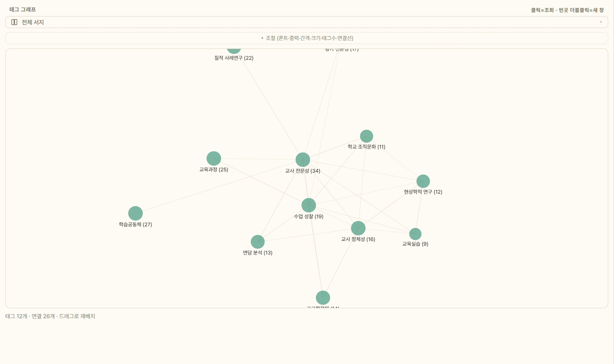

# 6. 서지 관리

[사용 설명서 목차](../USAGE.md)

## 6.1 마스터 서재(전체 서지)

- 사이드바의 **'전체 서지'** 에서 전체 목록.
- **`library.json` 이 원본 데이터**(원자적 저장). SQLite `.db` 는 검색 색인용 로컬 프로젝션(재생성 가능·클라우드 밖).
- 문제 시 환경변수 `IBIS_BACKEND=file`(옛 이름 `HWPENDNOTE_BACKEND` 도 그대로 인정)로 파일 백엔드 복귀.
- 서재 폴더를 클라우드에 두면 여러 PC 공유([9.6](09-settings.md#96-서재-위치클라우드-폴더-동기화)).

## 6.2 컬렉션(계층·색·드래그앤드롭)

1. 사이드바 '컬렉션' 옆 **＋** → 이름 입력.
2. 문헌(다중 선택 가능)을 컬렉션으로 **드래그**하거나 우클릭 › '컬렉션에 추가'.
3. 컬렉션 우클릭 → 색 팔레트·이름 변경·하위 컬렉션 추가·삭제.
4. 빼기: 컬렉션 뷰에서 문헌 우클릭 › '이 컬렉션에서 제외'(Del) 또는 '미분류로'.

- 카운트는 **하위 포함 재귀 합계**.
- 상위 컬렉션을 삭제하면 하위는 상위로 재지정되고, **문헌 자체는 서재에 남습니다.**

**흩어진 컬렉션 합치기** — 같은 주제를 여러 번 만들어 나뉘어 있을 때 하나로 모읍니다.

1. 사이드바에서 **Ctrl+클릭**(범위는 Shift+클릭)으로 컬렉션을 둘 이상 고릅니다.
2. 우클릭 › **[선택한 N개 합치기…]** → 어느 것을 남길지 고릅니다.

- **문헌은 지워지지 않습니다** — 컬렉션 구성만 바뀌고, 양쪽에 있던 문헌은 한 번만 남습니다.
- 없어지는 컬렉션의 **하위·스마트 컬렉션은 남는 컬렉션 밑으로** 갑니다(삭제는 상위로 올리는 것과 다릅니다).
- ⚠ **클라우드로 공유 중인 컬렉션은 없어지는 쪽이 될 수 없습니다** — 서재에서 사라지면 동료와의 공유가 끊기기 때문입니다.

## 6.3 스마트 컬렉션(조건 저장)

1. 사이드바 '컬렉션' 옆 **＋** › '새 스마트 컬렉션'.
2. 조건 입력: 검색어(제목·수록처·태그 포함) · 저자 · 태그(정확히 일치) · 연도 범위 · 유형. 빈 칸은 무시.
3. '만들기' → 조건에 맞는 문헌이 자동으로 묶임.

- 멤버십은 열 때마다 계산되므로 문헌을 추가·수정하면 자동 반영됩니다.
- 유형은 서지 유형 전체에서 고릅니다.

## 6.4 태그

- 상세 패널 태그칸에 **쉼표/세미콜론 구분**으로 입력(최대 20개).
- **AI 요약 실행 시 태그 자동 추가**(직전 AI 태그만 교체, 수동 입력은 보존).
- 웹판에는 별도 태그 목록이 없습니다 — **태그를 보는 주 인터페이스는 태그 그래프 뷰**.

## 6.5 태그 그래프 뷰

태그=노드, 같은 문헌에 함께 달린 태그=연결선(자체 포스 레이아웃, 외부 서재 없음). 노드 크기는 문헌 수에 비례.

1. 레일의 **그래프 아이콘**.
2. 상단 **스코프**: 전체 서지 / 컬렉션 / ⚡스마트 / 📄문서.
3. **'조절'** 펼치기: 폰트·중력·간격·크기·태그수(최대 60, 기본 40)·연결선(약한 공출현 숨김).
4. 조작:
   - 노드 **클릭** → 그 태그의 문헌이 중앙 목록에(스코프 유지)
   - 노드 **드래그** 재배치 · 빈 곳 드래그 팬 · 휠 줌
   - **호버** → 이웃만 밝게
   - 빈 곳 **더블클릭** → 별도 창
   - 노드 **우클릭** → 이름 변경·병합 / 삭제

- 태그가 없으면 그래프가 빕니다(AI 요약이 태그를 자동 생성).
- 스코프가 좁으면 비어 보일 수 있으니 '전체 서지' 로 확인.

## 6.6 태그 이름 변경·병합 / AI 태그 정리

- **개별** — 그래프에서 노드 우클릭 › '이름 변경·병합'. 대상 이름이 이미 있으면 자동 병합. '태그 삭제'로 전체 제거.
- **일괄(AI)** — `서재` › 'AI 태그 정리…' → 음차·번역·띄어쓰기 차이의 병합안 제안 → **적용할 묶음만 선택**해 반영(수십 초 소요, AI 설정 필요).
- 태그 정책: 표기 변형은 원어로 병합, 번역쌍은 `LLM(거대언어모델)` 식 병기 한 태그로 통합.

## 6.7 즐겨찾기 · 최근 추가 · 미분류 · 휴지통

- **★즐겨찾기** — 문헌 우클릭 › '즐겨찾기 토글'.
- **최근 추가** — 최근 30일에 담은 문헌. 같은 날 안에서도 시각순으로 정렬됩니다.
- **미분류** — 어느 컬렉션에도 속하지 않은 문헌.
- **휴지통** — 삭제는 곧바로 지우지 않는 soft delete.
  - 이동: 우클릭 › '휴지통으로 이동'(확인 팝업) 또는 레일 휴지통 아이콘으로 드래그.
  - 복원: 휴지통 뷰에서 우클릭 › '복원'(컬렉션 소속까지 복구).
  - '영구 삭제' 는 되돌릴 수 없습니다. 같은 인용키가 이미 있으면 복원이 실패합니다.

## 6.8 서지 직접 추가

검색으로 안 잡히는 자료(국역서·단행본·정부문서·법령 등).

1. 사이드바 **[＋ 새 문헌 추가] › '새 문헌 추가…'**(또는 `파일` › '새 문헌 추가…', `Ctrl+N`).
2. **붙여넣기** — 인용문이나 DB 내보내기 파일을 넣고 '파싱하여 추가'(본문 DOI 는 Crossref/KCI 로 확인).
3. **유형 선택** — 학술지·단행본·챕터·학술대회·학위논문·보고서·법령·조례·웹·신문기사(유형별 상세칸이 바뀜).
4. 확인·수정 후 '추가' → 인용키 자동 생성.

- **폼이 유형에 맞게 바뀝니다** — 유형을 고르면 그 유형이 실제로 쓰는 칸만 남습니다. 학위논문이면 수여기관·학위, 단행본 수록 장이면 수록서·편저자·판차·권, 법령이면 발령주체·호수·시행일 하는 식입니다. 적어 넣은 값은 모두 저장됩니다.
- **식별자로 채우기** — DOI 또는 ISBN 을 넣으면 조회해서 **빈 칸만** 채웁니다(입력한 값은 보존).
- **주소 한 줄로 온라인 자료·신문기사** — 같은 칸에 기사·웹 주소를 넣으면 제목·매체명·저자·게시일을 채우고 검색일을 오늘로 넣습니다. 페이지가 표준 정보를 주면 그것을 쓰고, 없으면 본문을 Ibis AI 가 읽어 뽑습니다.
- **KOSIS 통계표 주소로 담기** — 같은 칸에 통계표 주소(`statHtml.do?orgId=…&tblId=…`)를 넣으면 **데이터세트 서지**가 됩니다(표명·작성기관·통계조사·수록 기간·인출일). KOSIS 화면에서 찾은 표를 바로 인용할 수 있습니다.
- **앱 안 브라우저로 연 페이지 담기** — 로그인이나 스크립트가 필요한 기사·웹 페이지는 **[브라우저로 열기]** 로 앱 안 브라우저를 띄워 직접 이동한 뒤 **[열린 페이지 담기]** 를 누릅니다. 지금 떠 있는 페이지를 그 상태 그대로 읽어 제목·매체·저자·게시일을 채웁니다(주소 조회와 같은 방식).
- **단행본 서지 보완** — 카카오 책에서 **책소개·역자(저자와 분리)·ISBN**을 보완합니다. 국중도 상세 서지에서 확인한 원저자·원제도 채우며, 이미 서재에 있는 단행본에도 적용할 수 있습니다.
- **여러 권으로 된 책·연속간행물** — 단행본이 여러 권짜리면 **'권'** 칸이, 연속간행물이면 **'권·호'** 칸이 함께 나옵니다.
- **판본이 여럿이면 직접 고릅니다** — 같은 책의 초판·개정판·다른 출판사본이 함께 잡히면 후보를 보여 줍니다. 판차·출판사·연도를 보고 고르면 그 값으로 채웁니다.
- **초록** — 넣으면 전문검색·AI 요약에 활용(참고문헌에는 출력 안 함).
- **발행일** — 월·일까지 넣으면(예: 2023. 07. 22) 신문기사 참고문헌에 출력.
- **법령·조례** — 제정기관=저자칸, 발령주체=수록처칸, 호수=호칸(제N호).
- 완성형 서지(RIS 등)는 그대로 채우고 Crossref 매칭을 하지 않습니다. 제목·저자가 모두 비면 추가되지 않습니다.

## 6.9 중복 정리 · 첨부 관리 · 정렬

- **중복 정리** — `서재` › '중복 문헌 정리'. 몇 건을 합치는지 먼저 확인창으로 알리고 승인을 받습니다(되돌리기 어렵기 때문). 무엇을 합칠지 눈으로 보려면 사이드바 **중복 점검** 을 여세요. DOI 또는 정규화 제목+연도가 같은 문헌을 **가장 충실한 1건**에 병합(빈 필드 보강·첨부/키워드 합침·컬렉션 이관·★·이른 추가일 승계).
- **첨부(PDF)** — 우클릭 › '원문 확보'로 자동 첨부([7절](07-fulltext-pdf.md)). 서지 기반 자동 개명('첫저자 - 연도 - 제목'), 오첨부는 '다른 문헌으로 이동'.
- **담는 순간 이름이 정리됩니다** — PDF 를 끌어다 놓거나 원문 확보로 붙일 때 곧바로 '첫저자 - 연도 - 제목' 으로 바뀝니다. 아래 일괄 정리는 이전에 쌓인 것을 정리할 때 씁니다.
- **첨부 이름 일괄 정리** — `서재` › '첨부 이름 일괄 정리'(이전 이름: 첨부 자동 이름 정리). 서재 전체 첨부를 서지 기반 파일명으로 한 번에 정리하고 결과(정리·유지·실패)를 브리핑합니다.
- **한 건만 — [자동 이름]** — 이름 바꾸기 창의 **[자동 이름]** 을 누르면 **첫저자 - 연도 - 제목**을 칸에 채웁니다. 바로 바뀌지 않으니 보고 손볼 수 있습니다. 첨부 우클릭의 '자동 이름으로 바꾸기'도 다시 쓸 수 있습니다(국문 이름이 성만 남던 것도 고쳤습니다).
- **연결 안 된 PDF** — 첨부 '연결 해제' 는 파일을 지우지 않아 폴더에 남습니다. 사이드바 *기타* › '연결 안 된 PDF' 에서 파일마다 **추천 서지와 근거**(KCI 번호·제목 일치)를 보고, 행을 누르면 **첫 쪽 미리보기**와 PDF 에서 읽은 제목·저자·연도가 나옵니다. **[연결…]**(자동 후보 · 서재 검색 · DB 검색) · 추천 있는 것 **일괄 연결** · **새 서지로 만들기** · [되돌리기]. 필요 없는 파일은 삭제 대신 **격리 폴더**(`서재 폴더\_정리대기`)로 옮깁니다 — 여러 PC 가 서재 폴더를 같이 쓸 때 다른 PC 의 파일을 지우지 않기 위해서입니다.
- **정렬** — 컬럼 헤더 클릭 → 정렬, 다시 클릭 → 오름/내림(▲▼). 연도는 기본 내림차순, 텍스트는 오름차순. 헤더 경계 드래그로 폭 조절, 더블클릭으로 기본 폭 복원.

---

## 6.10 컬렉션 공유

컬렉션을 동료와 나눕니다. 두 방식이 있습니다.

| | 파일로 건네기 | 클라우드 공유 (베타) |
|---|---|---|
| 성격 | **한 번 건네고 끝** | **계속 맞춰 감** |
| 필요한 것 | 없음 | 구글 로그인 |
| 오프라인 | 됨 | 안 됨 |
| 받는 쪽이 고친 것 | 안 돌아옴 | 돌아옴 |

### 파일로 건네기 (`.ibiscol`)

1. 컬렉션 우클릭 › **[공유 파일로 내보내기 (.ibiscol)…]** — 하위 컬렉션까지 통째로 담깁니다.
2. 받는 쪽은 `파일` › **가져오기** › **[공유 컬렉션 가져오기 (.ibiscol)…]** 로 내 서재에 합칩니다.

- 메일·메신저·USB 어느 것으로 건네도 됩니다. 서버를 거치지 않습니다.
- 같은 문헌이 이미 있으면 중복으로 쌓지 않고 합칩니다(DOI 우선, 없으면 제목+연도).

### 클라우드 공유 (베타)

1. `⚙설정 › 클라우드` 에서 **[구글로 로그인]**. 로그인 창의 **[개인정보 처리방침 보기]** 로 무엇을 받아 가는지 먼저 볼 수 있습니다 — **받는 개인정보는 이메일 주소 1개**(참가자 식별·초대용)뿐이고 별도 가입은 없습니다.
2. 컬렉션 우클릭 › **[클라우드로 공유…]**.
3. 우클릭 › **[초대…]** 에 상대 구글 이메일을 적으면 **그 사람 Ibis 가 켜질 때** 초대가 뜹니다. 링크·문안 복사와 메일 앱으로 보내기도 함께 있습니다.

- 자동으로 동기화됩니다. 서지를 고치면 1분 안에 올라가고, 다른 창을 보다 Ibis 로 돌아올 때 한 번, 그리고 10분마다 전량을 맞춥니다. 사이드바 공유 배지가 동기화 중이면 돕니다.
- 우클릭 **[참가자·초대 관리…]** 로 누가 들어와 있는지 보고 잘못 나간 초대 링크를 끊습니다. 같은 창에서 초대장도 만듭니다. **[활동 기록…]** 은 누가 언제 무엇을 바꿨는지 보여 줍니다.
- **그만두기** — 우클릭 **[클라우드 공유 해제…]**. 소유자는 *서버에서 없애기* 와 *이 PC 연결만 끊기* 중에 고르고, 참가자는 **[공유에서 나가기]** 입니다.
- 상태줄에서 동기화 상태를 확인하고 **[모두 동기화]**를 실행할 수 있습니다. 실패하면 재시도 안내가 남으며, 이 PC의 서지는 그대로 보관됩니다.

### 내 서재 동기화 (여러 PC · 베타)

위의 컬렉션 공유가 *동료와* 나누는 것이라면, 이것은 **같은 구글 계정으로 로그인한 내 다른 PC** 와 **서재 전체**를 맞춥니다. `⚙설정 › 클라우드` › **[내 서재 동기화 (여러 PC)]**.

**동기화하는 모든 PC를 2026.10.1.0 이상으로 판올림하세요.** 구버전을 함께 쓰면 스마트 컬렉션·서재 설정이 누락될 수 있습니다. 이미 모든 사본에서 사라진 값은 복원하지 못합니다.

- 문헌·컬렉션 구성은 물론 **개인 메모·즐겨찾기·초록까지** 갑니다. 받는 쪽이 본인이기 때문입니다. **PDF 원문 파일은 여기서도 올라가지 않습니다.** **PDF 개인 클라우드 보관은 준비 중입니다** — 내 다른 PC 에서 PDF 원문까지 받을 수 있게 하는 기능으로, 지금은 일부 계정에서 시험하고 있습니다. 일반 사용자의 PDF 는 서버로 올라가지 않습니다.
- **다른 PC 에서 이미 켰다면 그것을 먼저 받아 합칩니다.**
- **한쪽에서 지운 것은 다른 PC 에서도 정리됩니다** — 문헌은 휴지통으로, 컬렉션은 없어지되 **그 안에 있던 문헌은 서재에 남습니다**. 무엇이 없어졌는지는 동기화 결과에 알립니다.
- **남과 나눌 수 없습니다** — 서재 동기화는 초대가 서버에서 거절됩니다. 동료와 나누는 것은 위의 컬렉션 공유이고, **둘을 함께 켜 두어도 됩니다.**
- **PDF 파일까지 여러 PC 에서 쓰려면** 지금처럼 서재 폴더를 OneDrive 같은 클라우드 폴더에 두세요 — 서재 동기화는 그것을 대체하지 않고, 폴더 동기화가 약한 부분(같은 서지를 양쪽에서 고쳤을 때 생기는 충돌본)을 서버가 칸 단위로 정리합니다. **둘을 함께 쓰는 것이 권장 구성입니다.**
- **컬렉션의 모양도 따라옵니다** — 이름·부모·색·순서·숨김을 바꾼 것, 스마트 컬렉션, 기본 인용 스타일과 서재 옵션(참고문헌 제목 등)이 다른 PC 에 반영됩니다. 접힘 상태·휴지통·PDF 본문 색인은 PC 마다 따로입니다.
- **끄기** — 기본은 이 PC 연결만 끊기입니다. 서버의 사본은 남아 다시 켜면 이어지고, 원하면 서버 사본까지 함께 지울 수 있습니다.
- ⚠ 다른 PC 에서 처음 켤 때 **합치기 미리보기는 아직 없습니다**(합치기만 하고 지우지는 않으며, 결과를 '새 문헌 N건'으로 알립니다).

### 무엇이 나가고, 무엇이 안 나가나 (두 방식 공통)

| 나가는 것 | 나가지 않는 것 |
|---|---|
| 서지 · 컬렉션 구성 | **PDF 원문 파일** |
| 하이라이트·메모(파일이 아니라 **위치와 문장**으로) | 개인 메모 · 즐겨찾기 |
| Ibis 가 만든 AI 요약 섹션 | 그 밖의 노트 |

- ⚠ 이 표는 **남에게 건네는 두 방식**(파일 공유·컬렉션 공유)의 규칙입니다. 바로 위의 **내 서재 동기화**는 받는 쪽이 나 자신뿐이라 개인 메모·즐겨찾기·초록도 함께 올라갑니다(PDF 원문은 거기서도 제외).

- 하이라이트가 문장으로 전달되므로, 받는 쪽이 원문을 확보해 열면 판본이 달라도 문장으로 자리를 찾아 붙습니다.
- PDF 를 보내지 않는 것은 저작권 때문입니다 — 받는 쪽이 자기 도서관 계정으로 확보하면 됩니다([7절](07-fulltext-pdf.md)).
- 클라우드는 **초록도 올리지 않습니다**(용량).

### 베타 한계 두 가지

1. **서지 교정은 칸 단위로 오갑니다**. 지난 동기화와 견주어 **내가 손대지 않은 칸**을 동료가 고쳤으면 받아 오고 **내가 고친 칸**은 지킵니다. 서로 다른 칸을 고친 것은 둘 다 삽니다. **같은 칸을 둘이 다르게 고친 경우에만** 나중 것으로 맞추고 **무엇이 덮였는지 알립니다** — 다만 시각 비교가 문헌 단위라 **같은 날 안에서의 앞뒤는 못 가립니다**. 중요한 교정은 서로 알려 주세요.
2. **컬렉션의 이름·색·정렬 순서를 바꾼 것은 전파되지 않습니다.** 참가자마다 달라지는 것을 막기 위해 제외했습니다. 문헌을 넣고 빼는 것은 정상으로 오갑니다.

---

[← 5. 참고문헌·인용 스타일](05-styles.md) · [목차](../USAGE.md) · [7. 원문 확보·PDF 뷰어 →](07-fulltext-pdf.md)
