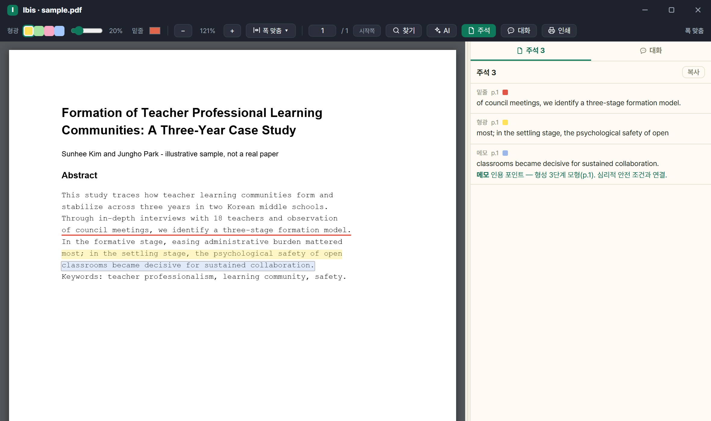

# 7. 원문 확보·PDF 뷰어

[사용 설명서 목차](../USAGE.md)

> **준법 정책** — 구독 학술 DB(DBpia·KISS·교보스콜라·ScienceDirect·Springer 등)에 자동으로 접속하지 않습니다. 자동 로그인·클릭·크롤링·다운로드를 하지 않고, 도서관 교외접속으로 **브라우저에 열어주기만** 합니다. 무료 공개(OA)·무료 기관 리포지터리만 자동 확보합니다.

## 7.1 OA 원문 자동 확보

1. 문헌 선택 → 상세의 **'원문 확보'**(다운로드 아이콘). 검색 결과 행에서 누르면 먼저 보관됩니다.
2. 시도 순서: **arXiv → Unpaywall → Semantic Scholar → 랜딩의 `citation_pdf_url` · KCI 무료원문.**
3. DOI 가 없으면 ScienceON→Crossref 로 DOI 를 보강해 재시도.
4. 확보되면 첨부되고 상태줄에 출처 표시.

- ⚙설정의 **'이메일'** 을 넣어야 Unpaywall 이 켜집니다(미설정 시 그 단계는 호출 없이 건너뜀).
- 검증: `%PDF` 매직 · 10KB 초과 · 100MB 미만 → HTML 오류·랜딩 페이지를 걸러냅니다.
- 이미 PDF 가 첨부된 문헌은 건너뜁니다.

## 7.2 일괄 확보 + 브리핑

- **방법 A** — `서재` › '원문 일괄 확보'(PDF 미보유 전체 — 이전 이름: PDF 일괄 확보).
- **방법 B** — 목록 다중 선택 → 우클릭 › '원문 확보 (N건)'.
- 진행률 `(i/N)` 과 **예상 남은 시간** 표시, 완료 후 `확보 N · 구독DB N · 미확보 N` 브리핑.
- 무료 건은 자동 다운로드, 구독DB 건은 '열기' 로 브라우저.

## 7.3 구독 DB 감지 → 도서관 교외접속 경유

1. `⚙설정` 의 **'도서관 경유 URL'** — **목록에서 소속 기관을 고릅니다**(34개 기관). 목록에 없으면 주소를 직접 넣습니다(예: `https://proxy.○○.ac.kr/_Lib_Proxy_Url/`). 옆의 **[확인]** 으로 그 주소가 실제로 응답하는지 눌러 볼 수 있습니다.
2. 구독 DB 로 판정되면 결과 팝업에 **벤더명 + '브라우저로 원문 페이지 열기'**.
3. 기본 브라우저로 프록시 경유 페이지가 열립니다.
4. **로그인 후 직접 다운로드** → 폴더 감시로 자동 첨부([7.6](#76-다운로드-폴더-감시--자동-첨부)).

- DOI 는 최종 랜딩까지 해석한 뒤 프록시로 감쌉니다. 이미 프록시된 주소는 이중 프록시하지 않습니다.
- 프록시는 로그인하지 않은 접근을 거부합니다. ⚙설정의 **[로그인 열기]** 로 먼저 로그인해 세션을 만드세요([9.4](09-settings.md#94-도서관-교외접속프록시-경유-설정)).

## 7.4 다중 제공처(RISS) · 학위논문 자동 확보

- **다중 제공처** — 한 논문이 여러 구독 DB 에 있을 때, 도서관 경유 URL 이 설정돼 있으면 RISS 를 숨김창으로 렌더해 제공처를 수초간 열거합니다. 2곳 이상이면 '○○로 열기' 버튼 → 기관에서 열리는 곳 선택(다운로드하면 자동 첨부). 무료 공개 메타인 RISS 만 읽습니다.
- **학위논문** — 무료 기관 리포지터리 경로(**RISS → dCollection**)를 자동으로 따라가 PDF 를 받아 첨부합니다(프록시·로그인 불필요). 성공 시 '원문 자동 첨부: 학위논문(dCollection)'. 이용 동의·DRM 으로 막히면 브라우저로 상세를 열고, 사용자가 받으면 폴더 감시로 첨부.

## 7.5 원문 URL 직접 붙여넣기

- 원문 확보 실패 팝업 › **'원문 URL로 확보…'**.
- 벤더 원문 페이지 URL 또는 도서관 검색의 프록시 주소를 붙여넣기 → 브라우저로 열림 → 받으면 자동 첨부.
- 프록시 주소를 그대로 넣으면 이중 프록시 없이 그대로 엽니다.
- 코리아스콜라 등 KCI·RISS 에 안 잡히는 DB 에 유용합니다.

## 7.6 다운로드 폴더 감시 → 자동 첨부

- 원문 페이지를 열면 앱이 단일 감시 스레드를 켭니다.
- 받은 PDF 가 어느 문헌 것인지 **파일 이름의 제목 → 저자·연도 → ISBN → PDF 첫 쪽의 DOI·제목** 순으로 맞춰 봅니다. 하나로 정해질 때만 자동 첨부합니다.
- 정하지 못한 파일은 **원문 확보 창 안의 '받은 PDF' 줄**(또는 상태줄 **📎 확인 대기**)에서 문헌을 골라 **[붙이기]** 합니다. 화면을 가로막는 확인 창은 뜨지 않습니다.
- 글자가 있는데 기다리는 어느 문헌과도 닿지 않는 PDF(그 사이 받은 다른 문서 등)는 붙이지 않고 **'관련 없어 보이는 PDF'** 로 접어 둡니다. 파일은 다운로드 폴더에 그대로 있습니다.
- 감시 대상: OS 다운로드 폴더 + 보조 폴더(`lib_downloads`). 대기 문헌이 없으면 무관한 다운로드는 건드리지 않고, 유휴 90초 후 종료.

## 7.7 인앱 PDF 뷰어와 주석

- 상세 패널의 첨부 클릭 → **앱 안 PDF 뷰어**(별도 창).
- 기능: 확대·축소 · 폭/쪽 맞춤 · 한쪽/두쪽 보기 · 페이지 이동 · 인쇄(주석 포함).
- **인쇄**: 툴바 **[인쇄]** 또는 `Ctrl+P`로 화면 확대율과 관계없이 고해상도로 인쇄합니다. A4 세로 영역에 쪽별로 맞추고 주석 위치를 유지합니다. 전체 쪽을 준비하며 준비 중 `Esc`로 취소할 수 있습니다. 주석이 있으면 마지막에 주석 모음을 붙입니다. PDF로 인쇄 저장한 본문은 이미지이며, 원래 PDF는 그대로 유지됩니다.
- **본문 찾기 `Ctrl+F`** — 열려 있는 PDF 전체에서 찾습니다. 아직 화면에 그려지지 않은 쪽도 포함하고, **띄어쓰기·줄바꿈·대소문자를 무시**해 PDF 특유의 줄 끊김에 걸리지 않습니다. `Enter`·`Shift+Enter` 로 다음·이전, `Esc` 로 닫습니다.
- **주석**: 형광펜(색·투명도)·밑줄·메모. 드래그 후 우클릭 또는 `H`·`U`·`N`. 목록 버튼으로 문서의 주석 모아보기.
- **수백 쪽 PDF(학위논문 등)** — 보이는 쪽만 먼저 그리는 지연 렌더로 큰 파일도 빠르게 엽니다. 인쇄 쪽번호 자동 인식이 틀리면 뷰어 툴바의 **'시작쪽'** 칸에 첫 페이지의 인쇄 쪽번호를 넣어(Enter) 쪽번호를 재계산·보정합니다.
- **글자가 안 보이는 쪽은 그 쪽만 다시 그립니다** — 뷰어가 그리지 못하는 글꼴 조합이 원인입니다. 글자가 빠진 쪽을 감지해 그 쪽만 Windows 내장 PDF 엔진으로 다시 그립니다(따로 설치할 것은 없습니다). 글자 선택·찾기·주석은 그대로입니다.
- **글자가 어긋나게 추출되던 PDF** — 화면은 정상인데 검색·AI 가 읽는 글자가 어긋나는 문서가 있습니다(`Korean Journal of Sociology` 가 `,PSFBO+PVSOBM` 처럼). 되돌릴 수 있는 것은 되돌리고, 되돌릴 수 없는 쪽은 그 쪽만 다시 읽습니다(요약·PDF 대화·쪽 찾기에서). 정상인 문서는 바뀌지 않습니다.
- **PDF 판본이 바뀌면** — 주석을 단 뒤 첨부 PDF 가 교체·변경되면 좌표가 어긋날 수 있어 주석 목록·상태줄에 **'⚠ PDF 가 바뀌어 위치가 어긋날 수 있음'** 이 표시됩니다. 주석에는 **PDF 판본 지문(sha256)과 선택 앞뒤 문맥 32자**를 함께 저장해 판본 변경을 알아채고 재정렬을 시도합니다.
- 저장: PDF 옆 `<파일명>.annots.json` 사이드카 → 서재 동기화를 따라감.
- 사이드바 **'주석 검색'** 으로 서재 전체 주석 검색 — 보관한 AI 문답([7.8](#78-pdf-창-대화-탭))도 함께 나오고 결과줄에 `주석 N · AI 대화 M` 으로 갈라 셉니다. **주석 개수 배지와 인쇄 모음은 주석만** 세므로 보관 답변으로 부풀지 않습니다.
- PDF 가 아닌 첨부는 OS 기본 앱으로 열립니다.

## 7.8 PDF 창 '대화' 탭

**지금 읽는 논문을 근거로** 묻고 답합니다. 이어서 되물을 수 있습니다.

논문 밖의 것 — 용어의 뜻, 그 방법의 통상적인 한계, 배경 — 도 물어볼 수 있고, **답이 어디서 왔는지 표시가 갈립니다**.

- 뷰어 툴바의 **[주석]·[대화]** 버튼 → 오른쪽 도크를 **탭 2개**(`주석 N` · `대화 ★N`)로 나눠 씁니다. 손잡이로 폭 조절(기본 400px).
- 입력: **`Ctrl+Enter` 전송**, Enter 는 줄바꿈. 버튼은 `새 대화` · `중지` · `보내기`.
- 답변이 생성되는 대로 표시됩니다(스트리밍 — Claude CLI·Antigravity CLI). [중지] 하면 받은 데까지 남습니다.
- 표시 세 가지:

  | 표시 | 뜻 |
  |---|---|
  | **(p.9)** 굵고 누를 수 있음 | 앱이 **원문에서 실제로 찾아 확인한** 근거. 누르면 그 자리로 갑니다 |
  | (일반 지식) | 논문 밖에서 온 답. 쪽을 붙이지 않습니다 |
  | (쪽 미확인) | 따옴표 친 인용인데 원문에서 못 찾았습니다. 인용하기 전에 확인하세요 |

  쪽 번호는 모델이 적은 것을 믿지 않고 **앱이 원문에서 되찾아 확정합니다.** 쪽을 걸친 인용(`p.3-4`)도 확인해 링크합니다.
- 남길 답은 **[보관]** 하면 상단에 접혀 쌓입니다. `새 대화` 는 새 대화를 시작하며, 지난 대화는 남습니다(아래).
- 본문이 길어 앞부분만 실렸으면 **몇 %만 읽었는지**를 답변 옆에 적습니다.
- 대화·주석 패널의 글자는 **고르고 복사할 수 있습니다.**
- **지난 대화** — 그 PDF 에서 주고받은 문답이 남습니다. 창을 닫았다 다시 열어도 이어서 물을 수 있고, 목록에서 옛 대화를 골라 되돌아갑니다.
- AI 제공자 설정이 필요합니다([8.4](08-ai.md#84-ai-제공자모델폴백)).

---

[← 6. 서지 관리](06-library.md) · [목차](../USAGE.md) · [8. AI 기능 →](08-ai.md)
