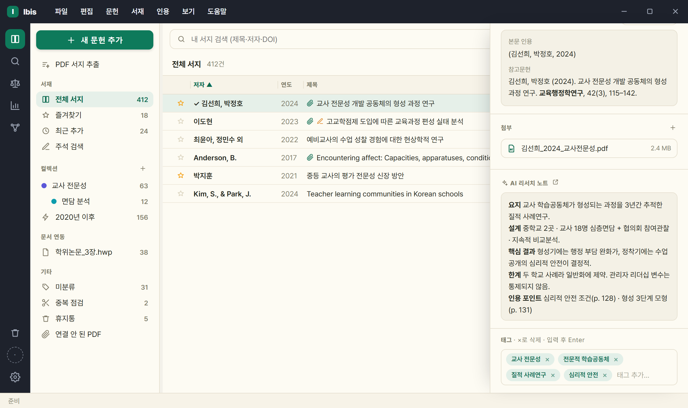
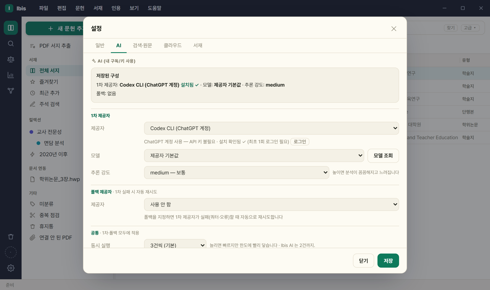

# 8. AI 기능

[사용 설명서 목차](../USAGE.md)

> AI는 **Ibis AI 크레딧**, 내 CLI·API 키 또는 **로컬 AI**로 쓸 수 있습니다([8.4](#84-ai-제공자모델폴백)). AI를 설정하지 않으면 AI 기능만 비활성이고 나머지는 그대로 됩니다.

## 8.1 AI 문헌 요약

첨부 PDF 본문을 읽어 한국어 요약 + 태그 + 키워드를 생성합니다.

**무엇을 뽑을지는 서지 유형에 따라 다릅니다** — 여섯 갈래로 나뉩니다.

| 유형 | 뽑는 것 |
|---|---|
| 실증 논문 | 연구질문·방법·핵심결과·시사점/한계 |
| 저술·논설 | 핵심 주장·논증 구조·반론 |
| 정책·연구 보고서 | 정책 문제·근거 자료·제안·이해관계 |
| 법령·법률안 | 목적·적용 대상·주요 조문·부칙 — 근거는 **조문 번호**로 |
| 판례·해석례 | 사실관계·쟁점·판단·법리 (비판적 검토는 평석 관점) |
| 회의록 | 안건·발언·쟁점·결정 |

상세 패널의 AI 버튼에 마우스를 올리면 **그 문헌에서 무엇을 뽑을지** 미리 말합니다('AI 법령 노트 — 목적·적용 대상·주요 조문·개정 연혁'). 태그를 뽑는 면도 유형마다 다릅니다(법령은 규율 주제·대상·기관).

1. 문헌에 **PDF 가 첨부돼 있어야** 합니다(없으면 먼저 원문 확보).
2. 상세의 **AI 아이콘** → 확인 팝업에서 '리서치 노트 실행'.
3. 여러 건은 선택 후 우클릭 › 'AI 요약 (N건)' → 순차 실행 + 건별 브리핑.
4. 저장 위치: 노트의 **`## AI 요약` 섹션** · 문헌 태그 · 서지 키워드.

- **스캔본도 읽습니다** — 글자가 없는 PDF 는 Windows 내장 글자 인식으로 본문을 뽑아 넘깁니다.
  - 처음 한 번은 시간이 걸립니다(수십 쪽이면 십수 초~수 분). 자동으로 실행됩니다. **시작하기 전에 먼저 알립니다** — 「스캔본입니다 — 글자를 먼저 읽습니다(42쪽). 긴 문서는 몇 분 걸릴 수 있습니다」(서지 채우기는 앞뒤 몇 쪽만 읽습니다). 그 뒤 진행이 **「스캔본이라 글자를 먼저 읽습니다 — 텍스트 인식 3/42쪽」** 으로 상태줄·진행 상자에 보입니다.
  - 한 번 읽어 두면 그 PDF 는 다음부터 바로 되고, 그때는 안내가 뜨지 않습니다.
  - AI 가 본문을 필요로 할 때만 실행됩니다(요약·비판적 검토·PDF 대화·서지 채우기). 뷰어로 여는 것만으로는 실행되지 않습니다.
- **재요약 시** 'AI 요약' 섹션과 직전 AI 태그·키워드만 교체하고 **사용자 메모·수동 태그는 보존**.
- 표기 분화를 막으려 내 서지 상위 태그(최대 40개)를 프롬프트에 함께 넘겨 기존 표기를 재사용합니다.
- 태그는 각 12자 이내·최소 4개, 주제·방법·대상 위주(일반어·메타어 배제).

**여러 건을 한꺼번에 — 동시 실행**

- 여러 편을 골라 일괄 요약을 실행하면 `⚙설정 › AI` 의 **[동시 실행]**(1~5, 기본 3)만큼 동시에 처리합니다.
- 값을 올려도 항상 빨라지지는 않습니다. 구독(CLI)은 사용량 한도에 더 빨리 닿고, API 키는 분당 한도에 걸립니다. 한도로 보이는 실패가 두 건 이상이면 결과 요약에서 낮추라고 안내합니다.
- ⚠ 이 설정은 **AI 호출에만** 걸립니다 — 학술DB 검색·원문 확보의 동시 요청 수는 따라 올라가지 않습니다.

## 8.2 서지정보 AI 채우기

DOI 가 있으면 Crossref·KCI 를 먼저 조회하고, 빈 항목이 남을 때만 PDF 표지를 AI 로 분석합니다.

1. 상세의 **마법봉 아이콘**. 여러 건은 우클릭 › '서지정보 채우기 (N건)'(동시 실행: CLI 2건·API 3건).
2. 진행: 'DOI 우선 확인 → 필요 시 PDF 분석'.
3. 완료 후 경로 안내: 'DOI 확인(KCI·Crossref)' · 'AI 생략' · 'AI 실패(DOI만 반영)'.

- 유형별로 채웁니다 — 학위논문=수여기관·학위 / 단행본·챕터·학술대회=출판사·출판지 / 학술지=학술지명·권·호·쪽.
- 영문 제목·학술지·저자는 병기 필드로.
- **DOI 만 있고 PDF 가 없어도** Crossref 로 채워집니다. 둘 다 없으면 '원문 확보 먼저' 안내.
- **다른 판을 잡으면 알립니다** — 단행본에서 조회 결과의 출판연도·판이 가지고 있는 서지와 어긋나면 덮어쓰기 전에 경고합니다. 같은 책의 다른 판은 쪽수가 달라 인용 쪽이 어긋나기 때문입니다.
- 기존 값은 덮어쓰지 않고 **빈 곳만 보완**(DOI 조회 값 우선).

## 8.3 AI 태그 정리

1. `서재` › 'AI 태그 정리…'(태그 2개 이상 필요).
2. 확인 팝업에서 '제안 받기'.
3. 제안이 **'표기/병기/삭제' 배지** + 대상 건수와 함께 표시 → 적용할 묶음만 체크 → '선택 병합 적용'.

- **검토 범위**를 고를 수 있습니다 — 몇 개의 태그까지 들여다볼지 지정합니다. 넓히면 더 많이 찾지만 그만큼 오래 걸리고 AI 사용량도 늡니다.
- AI 는 제안만 하고 **반영은 사용자가 고른 것만**.

## 8.4 AI 제공자·모델·폴백

`⚙설정 › AI 탭`. **1차 제공자**와 **폴백 제공자**를 각각 제공자·모델·추론 강도로 지정합니다.
두 자리는 같은 모양이고, '동시 실행'·'CLI 상태'는 맨 아래 «공통 · 1차·폴백 모두에 적용» 에 있습니다.

| 제공자 | 유형 | 필요 조건 |
|---|---|---|
| Claude CLI (구독) | 구독(키 불필요) | CLI 설치 + 1회 로그인 |
| Antigravity CLI (Google 구독) | Google 구독(키 불필요) | CLI 설치 + 1회 로그인 |
| Anthropic API 키 | API 키 | console.anthropic.com |
| OpenAI API 키 | API 키 | OpenAI |
| Gemini API 키 | API 키 | Gemini |
| Codex CLI (ChatGPT 계정) | 계정 로그인(키 불필요) | CLI 설치 + Codex를 이용할 수 있는 ChatGPT 계정으로 로그인 |
| 로컬 AI (Ollama·LM Studio) | 로컬 서버 | 실행 중인 서버 + 텍스트 생성 모델 |
| Ibis AI | 크레딧(키·CLI 불필요) | **구글 로그인**이 필요합니다(⚙설정 › 클라우드). 시작하면 **체험 크레딧 100**, [베타 무료 구독]을 시작하면 **하루 50크레딧**이 매일 채워집니다(아래 참고). 남은 양은 화면에 표시됩니다. |

- **Ibis AI 크레딧** — 글자 수(토큰) 기준 종량제라 짧은 요청은 적게, 수백 쪽 PDF 는 많이 듭니다. 실행 전에 예상 크레딧을 보여 주고 동의를 받으며, 남은 크레딧이 모자라면 그 자리에서 알립니다.
- **체험 100 → 베타 무료 구독** — 처음 시작하면 체험 크레딧 100 을 받습니다. 다 쓰면 채워지지 않습니다. 이어서 쓰려면 [베타 무료 구독] 을 시작하면 그 자리에서 하루 50크레딧이 매일 채워집니다. 승인 대기는 없습니다.
  - 베타 기간에는 요금이 없고 결제 수단도 받지 않습니다. 정식 요금이 정해지면 구독자에게 먼저 알리고, 그때 계속할지 선택합니다.
  - **이미 [베타 무료 구독]을 시작하신 계정은 그대로 하루 50크레딧입니다** — 판올림해도 바뀌지 않고 안내도 뜨지 않습니다.
  - 구독한 적 없는 계정은 판올림할 때 체험으로 옮겨지고 그때 안내가 한 번 뜹니다. 거기서 구독을 시작하면 다시 하루 50입니다.
  - 계정을 바꾸면 플랜과 남은 크레딧이 **즉시** 반영됩니다.
- **Ibis AI 가 바쁠 때는 기다립니다** — 여러 사람이 동시에 써서 서버 동시 한도에 걸리면 'AI 제공자 오류(429)' 대신 여유가 생길 때까지 최대 90초 동안 다시 시도합니다. 기다리는 동안 상태줄에 표시되고, 끝내 처리되지 않으면 그 사실을 알린 뒤 폴백 제공자가 있으면 그쪽으로 넘어갑니다. **'동시 실행'은 Ibis AI 에서 2건까지만** 적용됩니다.
- **Ibis AI를 고르면 모델·추론 강도 칸이 없습니다** — 작업별로 Ibis가 정합니다.
- **모델** — 조회를 지원하는 제공자는 **'모델 조회'**로 고르거나 직접 입력합니다. Codex는 비우면 CLI 기본 모델을 쓰며 모델명을 직접 지정할 수도 있습니다. 로컬 AI는 모델을 반드시 지정해야 합니다. 다른 CLI·API는 비우면 해당 기본값을 씁니다.
- **추론 강도(선택)** — 지원하는 제공자·모델에서 추론 강도를 고릅니다.
- **폴백 제공자(선택)** — 1차 실패 시 지정 제공자로 1회 자동 재시도(폴백도 제공자·모델·추론 강도를 따로 지정). 폴백 셀렉트 맨 앞은 **`사용 안 함`** 입니다.

**CLI 설치·로그인** — '설치' 버튼 → **1 설치 → 2 로그인 → 3 확인** 3단계 안내.

- 설치는 **별도 콘솔 창**에서 진행됩니다(무엇을 묻는지·왜 실패했는지 보이도록). 창을 기다리지 않고 앱이 3초 간격으로 확인합니다.
- 각 벤더의 **공식 설치 방법** 사용 — Claude Code 는 Node.js 없이 설치되는 네이티브 설치.
- **최초 1회 로그인 필요** — '로그인 창 열기' → 콘솔에서 CLI 실행 → 브라우저 인증. 콘솔이 있어야 끝낼 수 있어 창을 숨기지 않습니다.
- 설치 직후 **앱 재시작 불필요**(레지스트리 PATH·공식 설치 위치를 다시 확인).
- ⚠ '항상 위 고정' 이면 콘솔이 뒤에 열릴 수 있습니다 — 작업표시줄 확인.

Codex도 설정에서 설치·로그인·상태 확인·업데이트를 진행할 수 있습니다. ChatGPT 계정의 Codex 이용 가능 여부와 사용량 한도가 적용됩니다.

**로컬 AI 연결**

1. Ollama 또는 LM Studio를 따로 설치하고 텍스트 생성 모델을 준비한 뒤 서버를 실행합니다. Ibis가 모델을 내려받거나 서버를 대신 실행하지는 않습니다.
2. 1차 또는 폴백 제공자를 **로컬 AI (Ollama·LM Studio)**로 고르고, **로컬 서버 연결**에서 서버를 선택합니다. 기본 주소는 Ollama `http://localhost:11434/v1`, LM Studio `http://localhost:1234/v1`입니다. 인증이 필요한 서버만 전용 API 키를 입력합니다.
3. **연결 확인** 후 **모델 조회**로 모델을 고르거나 정확한 모델명을 입력하고 저장합니다.
4. **본문 상한 (자)**는 기본 4,000자이며 1,000~300,000자로 조정할 수 있습니다. 보내는 본문 분량을 정하는 값으로, 서버나 모델의 문맥 길이를 늘리지는 않습니다.

연결 성공은 답변 품질을 보장하지 않으므로 요약·쪽 근거를 원문과 확인하세요. 로컬 주소를 쓰더라도 서버가 클라우드 모델을 쓰거나 외부 제공자를 폴백으로 지정하면 본문이 외부로 전송될 수 있습니다([개인정보 처리방침](../PRIVACY.md#ai-제공자와-로컬-서버)).

오류 안내:

- **429** 사용량·속도 제한 → 잠시 후 재시도·다른 제공자/모델·폴백.
- **401/403** 인증·키 오류 · **400** 모델명 확인.
- 구 `gemini-cli` 설정은 `antigravity-cli` 로 자동 매핑.
- Antigravity(agy)는 stdin 을 읽지 않아 본문을 약 25,000자까지만 전달합니다(Windows 인자 한도).

---

[← 7. 원문 확보·PDF 뷰어](07-fulltext-pdf.md) · [목차](../USAGE.md) · [9. 설정·API 키 →](09-settings.md)
