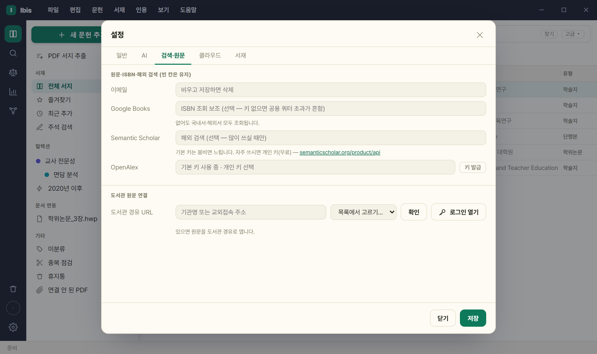
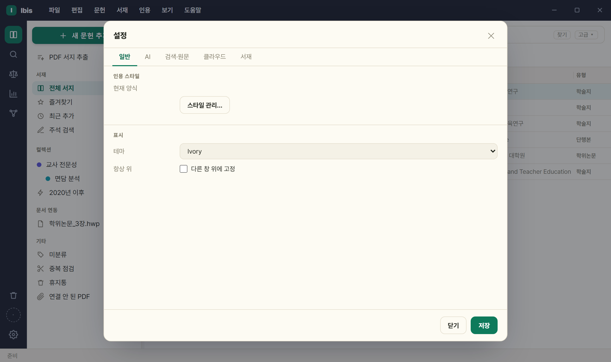
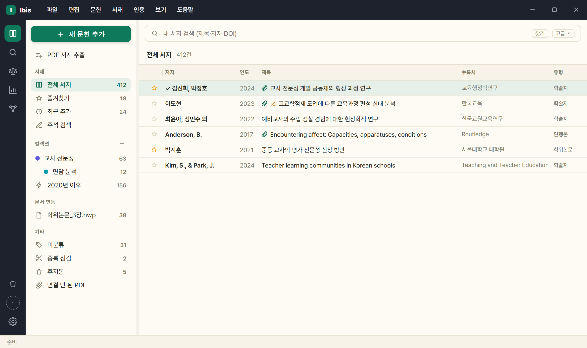
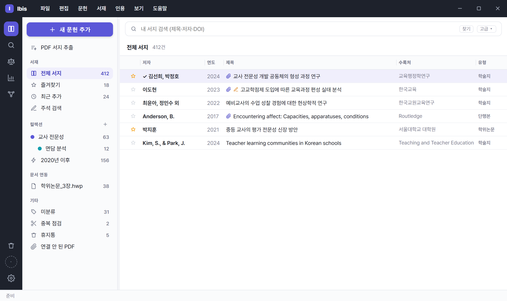
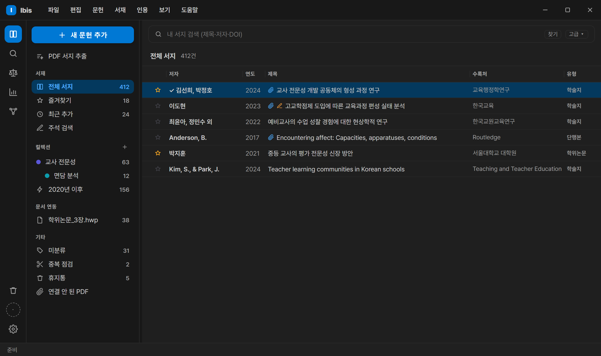
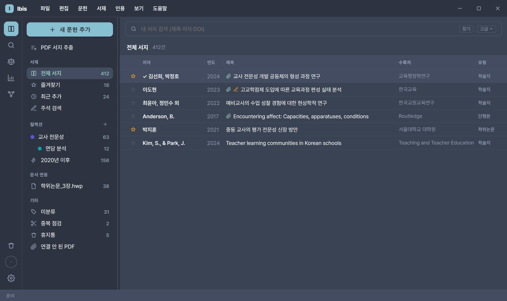
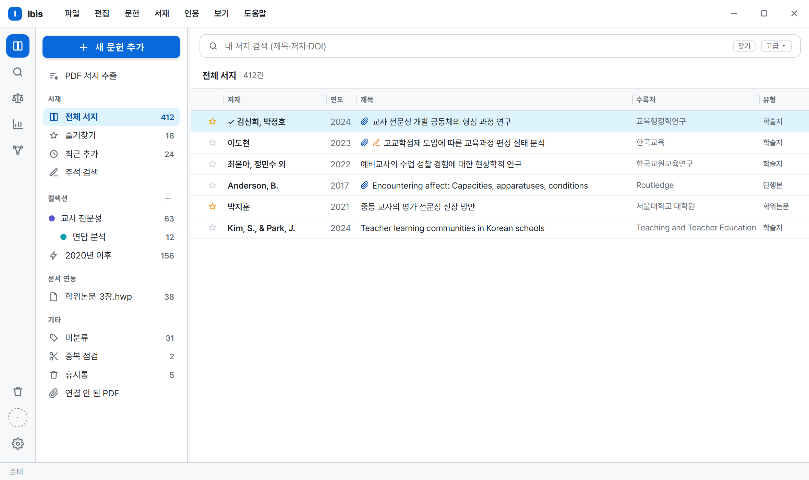
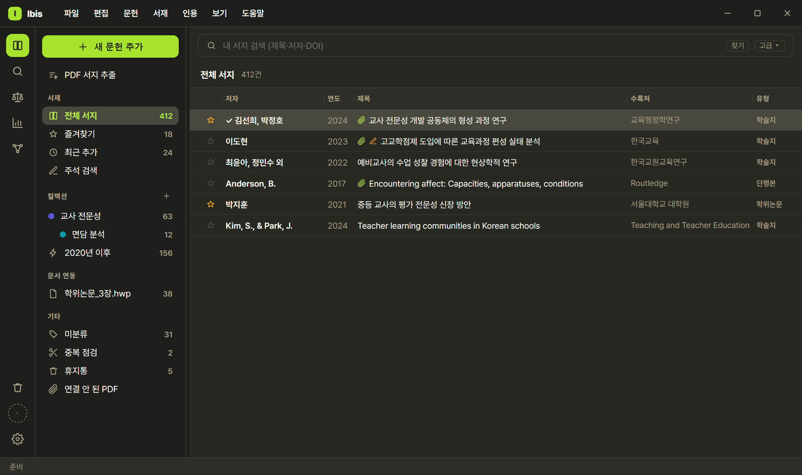
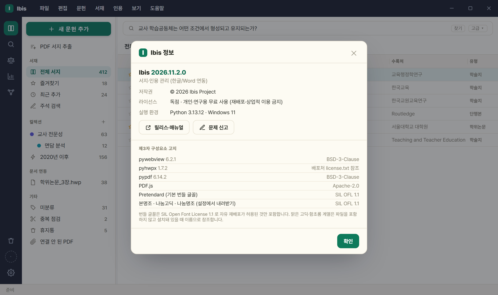

# 9. 설정·API 키

[사용 설명서 목차](../USAGE.md)

`⚙설정`(톱니)은 **일반 · AI · 검색·원문 · 클라우드 · 서재** 5개 탭입니다. 레일 맨 아래 ⚙ 로 엽니다.

| 탭 | 무엇이 있나 |
|---|---|
| **일반** | 인용 스타일([5절](05-styles.md)) · 표시(테마·글꼴·항상 위 — [9.7](#97-테마--글꼴--항상-위-고정)) |
| **AI** | 제공자·모델·추론 강도·폴백 + **일괄 작업 동시 실행**([8.4](08-ai.md#84-ai-제공자모델폴백)) |
| **검색·원문** | 이메일·선택 키([9.1](#91-api-키이메일-발급)) · 도서관 원문([9.4](#94-도서관-교외접속프록시-경유-설정)) |
| **클라우드** | 구글 로그인 · 공유 중인 컬렉션 목록 · 동기화 상태([6.10](06-library.md#610-컬렉션-공유)) |
| **서재** | 서재 위치·백업·업데이트 확인([9.6](#96-서재-위치클라우드-폴더-동기화)) · 애드온([2절](02-addons.md)) |

> **도구 패널은 없앴습니다.** 그 안에 있던 것은 이렇게 갈라졌습니다 — 가져오기·내보내기·컬렉션 공유는 `파일` 메뉴, 일괄 정리(중복·원문·AI 태그·첨부 이름)는 `서재` 메뉴, DOI·ISBN 추가는 `새 문헌 추가` 창의 **식별자로 채우기**, 서재 위치·백업·업데이트 확인과 클라우드 로그인은 `⚙설정` 입니다.

설정 칸은 대부분 **'빈 칸은 유지' 규칙**이라 비우고 저장해도 지워지지 않습니다(삭제는 '지움' 버튼).

## 9.1 API 키·이메일 발급

*(⚙설정 › 검색·원문 탭. 국내 학술 DB와 법·정책 DB는 내장 키로 사용합니다. 아래 개인 키·이메일·도서관 경유 주소는 선택 사항입니다.)*

| 항목 | 발급처 · 절차 | 입력 칸 | 문의 |
|---|---|---|---|
| **OpenAlex** | 발급 선택 — [무료 개인 키](https://openalex.org/settings/api) | `OpenAlex` | — |
| **Semantic Scholar** | 발급 선택 — `semanticscholar.org/product/api` (무료, 며칠 걸림) | `Semantic Scholar` | — |
| **이메일(OA·polite)** | 발급 아님. 본인 이메일(Unpaywall + Crossref polite pool) | `이메일` | — |
| **Google Books** | 발급 선택 — Google Cloud 콘솔의 Books API 키(단행본 ISBN 조회 보조) | `Google Books` | — |
| **도서관 원문 연결** | 발급 아님. 기관 프록시 주소([9.4](#94-도서관-교외접속프록시-경유-설정)) | `도서관 경유 URL` + `로그인 열기` — **칸 하나입니다**('도서관 홈페이지' 칸과 '항상 도서관 경유' 체크란을 뺐습니다) | — |

- **OpenAlex** — 기본 키로 바로 검색합니다. 기본 키의 이용 한도는 사용자들이 공유합니다. 개인 키를 넣으면 그 키를 우선하며, 지우면 기본 키로 돌아갑니다. 키 값은 설정 화면에 표시하지 않습니다.
- **Semantic Scholar** — 내장 키로 동작하지만 내장 키의 한도(초당 1회)는 모든 사용자가 나눠 씁니다. 자주 쓰면 개인 키를 넣으세요.
- **이메일 칸은 예외** — 비우고 저장하면 삭제됩니다. Unpaywall·Crossref 두 값에 같은 주소가 저장됩니다.
- **Google Books** — 단행본 **ISBN 조회** 보조용(선택, [3.4](03-search.md#35-isbn으로-단행본-추가)). 키 없이 쓰면 공용 쿼터 초과가 흔해 보조로만 씁니다. ISBN 조회 자체는 내장 키로 국립중앙도서관을 씁니다.
- **키를 하나도 넣지 않아도** 학술 DB 9종과 법·정책 5갈래가 전부 동작합니다. 개인 키와 이메일은 선택 사항입니다.

## 9.2 저장된 키 삭제 — '지움'

1. 설정된 키는 `● 설정됨` 으로 표시되고 옆에 **'지움'** 버튼이 나타납니다.
2. '지움' → **'저장'** → 실제 삭제됩니다. 지워도 검색은 그대로입니다 — 개인 키를 지워도 OpenAlex·S2는 기본 키로 돌아가며, 다른 검색 DB도 사용자 키 없이 사용할 수 있습니다.

- 환경변수(`SCIENCEON_*`·`UNPAYWALL_EMAIL` 등)로 설정된 값은 외부 구성이라 UI 에서 지워지지 않습니다.

## 9.3 AI 제공자 설정

- ⚙설정 **AI 탭**. **1차 제공자**·**폴백 제공자**를 각각 지정하고, 제공자마다 **모델**('모델 조회'로 불러와 드롭다운에서 선택)과 **추론 강도**를 고릅니다 — 자세히는 [8.4](08-ai.md#84-ai-제공자모델폴백).

## 9.4 도서관 교외접속(프록시) 경유 설정

⚙설정 **검색·원문 탭**의 '도서관 원문 연결' 영역입니다.

1. **'도서관 경유 URL'** — 기관 프록시 주소(예: `https://proxy.knue.ac.kr/_Lib_Proxy_Url/`). 목록에서 고르거나 직접 넣습니다.
2. **'로그인 열기'** 로 브라우저에서 먼저 한 번 로그인해 세션을 만듭니다(그 주소의 로그인 페이지가 열립니다).

**칸이 하나입니다** — '도서관 홈페이지' 칸과 '원문 열기 시 항상 도서관 경유' 체크란을 뺐습니다. 경유 URL 하나가 로그인 주소와 경유 여부를 함께 정합니다: 넣으면 원문 열기·확보가 도서관을 거치고(법제처·국회도서관·KCI 같은 무료 사이트는 바로), 비워 두면 늘 바로 엽니다.

- 이전에 경유 URL 만 넣고 체크란은 켜지 않았던 경우, 이제 경유로 열립니다. 교내 고정 IP 처럼 경유가 오히려 방해되는 드문 경우는 환경변수 `LIBRARY_PROXY_AUTO=0` 으로 끕니다(화면에는 없습니다).

형식은 **자동 인식**됩니다 — 교외에서 DB 를 눌렀을 때 나온 주소를 그대로 붙여넣으면 템플릿으로 변환합니다.

- 경로형: `…/_Lib_Proxy_Url/` → `{urlraw}` (대상이 경로 세그먼트로 들어감)
- 쿼리형: `…/login?url=` → `{url}` (대상을 URL 인코딩)
- ⚠ **호스트가 이미 치환된 주소**(`https://www-sciencedirect-com.proxy.○○.ac.kr/…`)는 넣지 마세요 — 리다이렉트 **결과**라 템플릿이 되지 못합니다. 도서관 DB 목록에서 **링크 주소 복사**로 원본을 얻으세요.

주의:

- 로그인하지 않으면 프록시가 접근을 거부하므로 먼저 로그인해야 합니다.
- 로그인 정보는 저장하지 않습니다(브라우저 세션만 사용).
- 구독 DB 원문은 자동으로 받지 않고 **사용자가 브라우저에서 직접** 받습니다.
- KCI 무료 원문·Google Scholar 는 프록시에서 제외됩니다.

## 9.5 데이터·비밀정보 저장 위치

| 항목 | 기본 위치 | 클라우드 동기화 |
|---|---|---|
| 서재(서지) | 새 설치는 `문서\Ibis\library.json`(기존 사용자는 `%LOCALAPPDATA%\Ibis\library.json`) | 폴더를 클라우드로 지정 시 O |
| 첨부 PDF | 서재 폴더의 `attachments\` | 서재를 따라감 |
| docstore(문서별 인용) | 서재 폴더의 `docstore\` | 서재를 따라감 |
| 저널 스타일 | 서재 폴더의 `journal_styles\` | 서재를 따라감 |
| 받은 글꼴(2026.9.4 까지) | `%LOCALAPPDATA%\Ibis\fonts\` | X (PC 로컬) — 2026.9.5 부터 쓰이지 않음 |
| 비밀정보(API 키·테마·AI) | `%LOCALAPPDATA%\Ibis\secrets.json` | **X (항상 로컬)** |

- 옛 폴더(`%LOCALAPPDATA%\hwp-endnote`)를 쓰던 사용자는 **첫 실행 때 파일 단위로 자동 이관**되므로 할 일이 없습니다.
- 비밀정보는 권한 `0o600` 으로 저장되며 항상 로컬 — **클라우드 서재를 써도 API 키·테마·글꼴·AI 설정은 PC 마다 따로** 넣어야 합니다.
- **환경변수가 `secrets.json` 보다 우선**합니다(`SCIENCEON_*`·`UNPAYWALL_EMAIL`·`LIBRARY_PROXY_PREFIX/AUTO`·`LIBRARY_LOGIN_URL`·`IBIS_LIBRARY` 등).
- 서재 경로 우선순위: env `IBIS_LIBRARY` > secrets `library_path` > 기본.
- 옛 환경변수 이름 `HWPENDNOTE_LIBRARY`·`HWPENDNOTE_BACKEND` **도 그대로 인정**됩니다(새 이름 `IBIS_LIBRARY`·`IBIS_BACKEND` 가 우선).
- `⚙설정 › 서재 › '탐색기에서 보기'` 로 확인.

## 9.6 서재 위치·클라우드 폴더 동기화

`⚙설정 › 서재` 탭입니다(`파일` › '설정 › 서재…' 로도 바로 열립니다).

| 버튼 | 동작 |
|---|---|
| **폴더 변경** | 현재 데이터(+첨부·docstore·저널 스타일)를 지정 폴더로 이전. 대상에 `library.json` 이 있으면 그것을 **채택**, 없으면 **복사·이전** |
| **새로 만들기** | 빈 폴더에 새 서재 생성 후 전환(이미 있으면 오류). **확인문**이 먼저 뜹니다 — 지금 서재의 서지 건수, 첨부가 따라오지 않는다는 것, 다른 서재를 이어 쓰려면 [열기]라는 것, 내 서재 동기화가 켜져 있을 때의 결과 |
| **열기** | 다른 폴더의 기존 서재에 **복사 없이 연결·전환**(없으면 오류) |
| **사본 저장(백업)** | 다른 폴더로 **복사만**(전환 안 함). 대상에 이미 있거나 현재와 같으면 오류 |

- '새로 만들기'·'열기' 는 전환 전에 현재 서재를 자동 저장합니다.
- 서재가 바뀔 때마다 `%LOCALAPPDATA%\Ibis\library_switch.log` 에 한 줄(언제·어디서·어디로)이 남고 직전 위치를 기억합니다. 어느 날 첨부가 전부 안 보이면 먼저 이 탭의 **서재 위치**가 쓰던 폴더인지 보세요 — 다른 곳이면 [열기]로 그 폴더를 고르면 됩니다.
- **'이 PC 의 서재' 목록** — 이 PC 에서 써 본 서재가 **둘 이상일 때** 이 탭에 목록이 생깁니다(하나뿐이면 안 보입니다). 줄마다 서지 건수가 적혀 있어 어느 쪽이 쓰던 서재인지 구분할 수 있고, [열기]로 바꿉니다.
- **빈 서재에서 내 서재 동기화를 켜면 먼저 묻습니다** — 서버 사본이 내려와 채워지지만 **첨부 PDF 는 따라오지 않습니다**. 원래 쓰던 서재가 이 PC 에 있으면 **[그 서재 열기]** 와 **[여기서 켜기]** 중에 고를 수 있습니다.
- **여러 PC 공유** — 한 PC 에서 클라우드 폴더로 '이전' → 다른 PC 에서 '열기' 로 연결. 서지·첨부·docstore·저널 스타일까지 동기화(비밀정보 제외).

## 9.7 테마 · 글꼴 · 항상 위 고정

`⚙설정 › '일반' › 표시`.

**테마 16종** — 고르는 즉시 열려 있는 모든 창에 적용되고 저장됩니다. 기본값은 **Ivory**(그전에 쓰시던 분의 테마는 그대로 유지됩니다).

- 자체 제작 4종: Slate · Ivory · Bright · Graphite → 타이틀바·레일이 **다크 고정**(원 디자인).
- 다크 8종: Dark Modern · One Dark Pro · Dracula · Nord · Monokai · Tokyo Night · Solarized Dark · GitHub Dark.
- 라이트 4종: Solarized Light · GitHub Light · Quiet Light · Ayu Light.
- 자체 제작 4종 외에는 **크롬(타이틀바·레일)까지 테마 색**을 따릅니다.

| | |
|---|---|
|  **Ivory — 기본**(종이톤) |  Slate |
|  Dark Modern |  Nord |
|  GitHub Light |  Monokai |

**글꼴** — 화면 글꼴은 **Pretendard 하나**입니다. 글꼴 선택과 내려받기(본명조·나눔·JetBrains Mono)를 뺐고, 종이톤 테마 둘도 Pretendard 로 맞췄습니다. Pretendard 를 못 쓰는 환경에서는 맑은 고딕으로 대체됩니다. 예전에 받아 둔 글꼴 파일(`%LOCALAPPDATA%\Ibis\fonts`)은 더 쓰이지 않으니 지워도 됩니다.

**항상 위 고정** — '다른 창 위에 고정' 체크 시 본창이 한글/Word 위에 유지됩니다.

- **저장되지 않아 재시작하면 해제**됩니다(매번 다시 체크).
- 본창에만 적용(설정·그래프·상세·PDF 등 별도 창 제외).
- 별도 창(PDF·설정)은 **화면 배율(125·150%)에서도 보고 있던 모니터 안에** 뜹니다(화면 밖으로 나가던 문제를 고쳤습니다).
- 테마·항상 위 설정은 PC 로컬(`secrets.json`)이라 클라우드로 공유되지 않습니다.

## 9.8 온보딩을 건너뛰었다면

- 모든 항목(서재 위치·이메일·AI, 그리고 온보딩에 없는 도서관 경유)은 `⚙설정` 에서 언제든 변경 가능.
- 이미 데이터가 있으면 온보딩 창은 다시 뜨지 않습니다.

## 9.9 도움말 › Ibis 정보 — 버전·저작권·라이선스

`도움말 › 'Ibis 정보 · 라이선스'` 에서 확인합니다.

- 표시 항목: 제품명·버전 · 저작권 · **배포 라이선스** · 실행 환경 · **제3자 구성요소 고지**(구성요소별 라이선스) · 릴리스·문제 신고 링크.
- Ibis 는 **개인·학술·연구·교육 목적 무료**이며 재배포·판매·유료 서비스 포함·역공학은 허용되지 않습니다(전문은 `LICENSE`).
- **Ibis 로 만든 서지 데이터와 문서는 전적으로 사용자의 것입니다.**
- 오픈소스 구성요소는 각자의 라이선스를 따르며, 번들 글꼴은 자유 재배포가 허용된 SIL OFL 1.1 만 포함합니다.

---

[← 8. AI 기능](08-ai.md) · [목차](../USAGE.md)
